# AN ATTENTION-BASED FEATURE MEMORY DESIGN FOR ENERGY-EFFICIENT CONTINUAL LEARNING

Yuandou Wang, Filip Gunnarsson, and Rihan Hai Web Information Systems, EEMCS Delft University of Technology Delft, 2628 XE, The Netherlands

## ABSTRACT

Tabular data streams are increasingly prevalent in real-time decision-making across healthcare, finance, and the Internet of Things, often generated and processed on resource-constrained edge and mobile devices. Continual learning (CL) enables models to learn sequentially from such streams while retaining previously acquired knowledge. While recent CL advances have made significant progress in mitigating catastrophic forgetting, the energy and memory efficiency of CL for tabular data streams remains largely unexplored. To address this gap, we propose AttenMLP, which integrates attention-based feature replay with context retrieval and sliding buffer updates within a minibatch training framework for streaming tabular learning.

We evaluate AttenMLP against state-of-the-art (SOTA) tabular models on realworld concept drift benchmarks with temporal distribution shifts. Experimental results show that AttenMLP achieves accuracy comparable to strong baselines without replay, while substantially reducing energy consumption through tunable design choices. In particular, with the proposed attention-based feature memory design, AttenMLP costs a 0.062 decrease in final accuracy under the incremen tal concept drift dataset, while reducing energy usage up to 33.3% compared to TabPFNv2. Under the abrupt concept drift dataset, AttenMLP reduces 1.47% energy consumption compared to TabR, at the cost of a 0.038 decrease in final accuracy. Although ranking third in global efficiency, AttenMLP demonstrates energy-accuracy trade-offs across both abrupt and incremental concept drift scenarios compared to SOTA tabular models.

## 1 INTRODUCTION

Tabular data, structured as a collection of features and instances, is one of the most common and practical data types in practical machine learning applications, for example, in both high-stakes domains and lower-stakes domains (Amrollahi et al., 2022; Ramjattan et al., 2024; Li et al., 2025b). As such domains increasingly rely on streaming data sources, tabular data streams are gaining significant attention due to their ability to capture continuous, real-time updates rather than static snapshots (Borisov et al., 2022). In particular, most such scenarios often occur on edge devices, IoT systems, and mobile platforms, where energy budgets, battery life, and computational resources are severely constrained (Chang et al., 2021).

To tackle those real-world dynamics, continual learning (CL) (Wang et al., 2024), also referred to as lifelong learning (Lee & Lee, 2020), enables models to incrementally acquire, update, accumulate, and exploit knowledge over time. While significant progress has been made on overcoming catastrophic forgetting (Kemker et al., 2018; Li et al., 2019; Bhat et al., 2022) and knowledge transfer (Ke et al., 2021; Li et al., 2024; Shi et al., 2025), much less is known about their computational analysis and energy efficiency (Li et al., 2023; Trinci et al., 2024).

Energy-efficient continual learning (EECL) has become a practical necessity for real-world applications that require real-time adaptation on resource-constrained platforms (Chavan et al., 2023; Shi et al., 2024; Trinci et al., 2024; Xiao et al., 2024). Meanwhile, most CL progress to date targets image (Trinci et al., 2024; Chavan et al., 2023; Shi et al., 2024) and language tasks (Li et al., 2025a;

Wang et al., 2024). In contrast, tabular data streams remain underexplored. Tabular models that excel on static datasets do not transfer directly to non-stationary streams with tight memory, compute, and energy budgets. Existing CL methods rarely target these constraints. In particular, replay-based strategies rely on buffers that grow over time, increasing storage and compute, and hindering ondevice deployment. This gap motivates methods for tabular streaming CL that sustain accuracy under distribution shift while operating at low energy cost, with fixed memory, and without storing raw examples. Moreover, trade-offs between energy consumption and predictive performance matter in lower-stakes domains, especially when the cost of electricity is taken into account. Achieving this under strict resource budgets while mitigating catastrophic forgetting remains a central challenge for Green AI (Henderson et al., 2020; Heguerte et al., 2023; Trinci et al., 2024).

This paper introduces AttenMLP, a novel EECL method for tabular streams, which integrates an attention-based feature memory for dynamic retrieval of historical embeddings, mitigating catastrophic forgetting. We utilize a multilayer perceptron (MLP) backbone to support this mechanism, leveraging its superior representation learning and high edge throughput. To be specific: 1) AttenMLP employs a windowed scaled dot-product attention with a sliding feature buffer, enabling the model to adaptively attend to the most relevant parts of the stream while storing only latent features without needing to revisit raw historical data. 2) The resulting attended representation is concatenated and passed through two shared feed-forward layers followed by a classifier head, serving as the MLP learner for classification tasks. This design avoids the unbounded memory growth inherent to replay baselines (Rebuffi et al., 2017; Li & Hoiem, 2017; Lopez-Paz & Ranzato, 2017), while remaining computationally lightweight on resource-constrained devices. To evaluate energy-accuracy trade-offs in CL on tabular data streams, we provide quantitative Pareto status and global efficiency analysis.

## 2 RELATED WORK

Traditional tabular data models can be roughly categorized into three main groups: gradient-boosted decision trees (GBDTs), neural networks (NNs), and classic models.

GBDTs and their variants for CL. Traditional GBDTs such as XGBoost (Chen & Guestrin, 2016), LightGBM (Ke et al., 2017), and CatBoost (Prokhorenkova et al., 2018) remain strong baselines for tabular classification due to their efficiency and robustness, especially on large or irregular static datasets. However, they are not naturally suited for CL: (1) new data typically requires retraining from scratch, since tree splits and boosting weights depend on the full dataset (Chen & Guestrin, 2016; Ke et al., 2017; Prokhorenkova et al., 2018); (2) without access to past data, models trained only on new samples overwrite previous knowledge, causing catastrophic forgetting (Wang et al., 2024); and (3) unlike NNs, GBDTs lack mechanisms for knowledge transfer across tasks (Ke et al., 2021; Parisi et al., 2019; De Lange et al., 2021). Extensions such as online bagging and boosting (Oza & Russell, 2001) or warm-starting (Pedregosa et al., 2011), and adaptive XGBoost (Montiel et al., 2020), partially mitigate these issues, but remain limited in long-term knowledge retention due to the lack of representation reuse, especially when compared to neural CL methods.

Classic models in CL. Both standard SVMs (Cortes & Vapnik, 1995) and decision trees (Loh, 2011) are batch learners, requiring retraining on the full dataset when new tasks arrive. SVMs can be extended to CL through incremental or online variants such as incremental SVM (Cauwenberghs & Poggio, 2000), LASVM (Bordes et al., 2005), and NORMA (Kivinen et al., 2004), which handle streaming updates but still face challenges with scalability, memory growth, and forgetting. k-NNs (Cover & Hart, 1967) trivially avoid forgetting if all data is stored, but this violates the constraint of no access to past raw inputs and is impractical under resource limits. Linear models (Cox, 1958) are efficient but prone to forgetting under distribution shifts, as updates overwrite prior knowledge. Incremental decision trees, such as Hoeffding trees (Domingos & Hulten, 2000), and streaming ensembles (Bifet et al., 2010; Gomes et al., 2017) can adapt to data streams without full retraining. Still, their accuracy degrades under severe drift, since they lack strong representation learning, and ensemble methods can be computationally expensive.

Neural models in CL. Recent studies show that advanced NNs (Zabërgja et al., 2024; Arik & Pfister, 2021; Kadra et al., 2021; Gorishniy et al., 2023; Hollmann et al., 2025; Ye et al., 2024; Gorishniy et al., 2024) can surpass GBDTs on static tabular data in certain regimes, e.g., with well-regularized MLPs (Kadra et al., 2021), attention-based models such as SAINT (Somepalli et al., 2021), or metalearned foundation models like TabPFN (Hollmann et al., 2025). While their training or inference is typically more computationally intensive than that of GBDTs unless carefully tuned (Kadra et al., 2021), NNs are generally better suited for streaming data, owing to their rich representations, incremental updates via stochastic gradient descent, and flexible architectures. However, vanilla NNs still suffer from catastrophic forgetting in the absence of CL strategies (Wang et al., 2024).

CL strategies with neural models. In NNs, CL methods are commonly categorized into regularization-based approaches (Kirkpatrick et al., 2017; Zenke et al., 2017), replay-based strategies (Rebuffi et al., 2017; Shin et al., 2017), attention-based retrieval mechanisms (Xu et al., 2019), and architectural methods (Rusu et al., 2016). Regularization-based methods, such as EWC (Kirkpatrick et al., 2017), SI (Zenke et al., 2017), MAS (Aljundi et al., 2018), A-GEM (Chaudhry et al., 2018), and LwF (Li & Hoiem, 2017), mitigate forgetting by constraining updates to parameters deemed important for previously learned tasks. Replay-based strategies, including iCaRL (Rebuffi et al., 2017) and generative replay (Shin et al., 2017), maintain past knowledge by rehearsing stored samples or synthetic data. Attention-based retrieval mechanisms, such as attentive experience replay (Xu et al., 2019), utilize an attention mechanism to leverage previous knowledge. Architectural methods, exemplified by PNNs (Rusu et al., 2016), expand model capacity by freezing previously trained components and introducing new modules for incoming tasks.

Despite recent progress, EECL for tabular data streams remains largely unexplored (Chavan et al., 2023; Trinci et al., 2024). Real-world tables frequently undergo domain drift (e.g., quarterly finance transactions, evolving sensor logs, healthcare data) without changes to the label space. Yet, no standardized domain-incremental learning benchmark that considers energy-performance trade-offs currently exists for tabular streams. Moreover, pre-trained transformers for tabular data (Gorishniy et al., 2021; Hollmann et al., 2025) and feature-level or attention-based CL strategies (Vaswani et al., 2017; Li et al., 2025a; Somepalli et al., 2021) show promise for low-storage, privacy-preserving CL, but their effectiveness under concept drifts has not been systematically evaluated. Here, we bridge this gap by introducing our method, establishing fair comparisons, and quantifying energy–performance trade-offs.

## 3 ATTENMLP FOR EECL

Owing to the general difficulty and diversity of challenges in CL, we focus on a simplified task incremental learning setting (Parisi et al., 2019; De Lange et al., 2021). In this setting, a model is trained on a sequence of tasks $\{ \mathcal { T } _ { t } \} _ { t = 1 } ^ { T }$ , where the data for each task arrives incrementally at time t.

## 3.1 PROBLEM STATEMENT

Given a sequence of tasks $\{ \mathcal { T } _ { t } \} _ { t = 0 } ^ { T }$ arriving incrementally, each task $\mathcal { T } _ { t }$ consists of data $( \mathcal { X } _ { t } , \mathcal { Y } _ { t } )$ sampled from a distribution $\mathcal { D } _ { t \cdot } ^ { \phantom { \dagger } } \tilde { \mathcal { X } _ { t } } = \{ \boldsymbol { x } _ { t , i } \} _ { i = 1 } ^ { n _ { t } }$ represents the input features and $\mathcal { V } _ { t } = \{ y _ { t , i } \} _ { i = 1 } ^ { n _ { t } }$ denotes the corresponding ground truth labels. The goal is to learn under concept drift (Souza et al., 2020; Hoens et al., 2012), where the relationship between $\mathcal { X } _ { t }$ and $\mathcal { X } _ { t + 1 }$ evolves, i.e., $\mathcal { D } _ { t } \neq \mathcal { D } _ { t + 1 }$

We aim to design an incremental learner $f _ { \theta }$ that updates online and minimizes the expected risk $\hat { L } _ { t } ( \theta )$ across all observed tasks, with no access to the data from earlier tasks,

$$
\hat {L} _ {t} (\theta) := \sum_ {t = 0} ^ {T} \mathbb {E} _ {(\mathcal {X} _ {t}, \mathcal {Y} _ {t}) \sim \mathcal {D} _ {t}} [ \ell_ {t} (\theta) ],\tag{1}
$$

where $\ell _ { t } ( \theta )$ represents the loss function of the incremental model $f _ { \theta }$ with input $\mathcal { D } _ { t } .$ , parameter θ and the historical information at time t. Additionally, we aim to achieve energy efficiency.

We formalize this with standard non-convex optimization assumptions.

(A1) There exists $R _ { \mathcal { X } } > 0$ such that for all $t , i$ and all samples $x _ { t , i } \in \mathcal { X } _ { t }$ , we have $\| x _ { t , i } \| _ { 2 } \leq R _ { \mathcal { X } }$ (A2) The precomputed latent features are ℓ2-normalized, i.e., $\| h _ { t , j } \| _ { 2 } \leq 1 f o r a l l t , j$

(A3) Training is performed with weight decay and early stopping, so that for some $R _ { \theta } ~ > ~ 0$ $\| \theta \| _ { 2 } \le R _ { \theta }$ throughout optimization.

## 3.2 ARCHITECTURE OVERVIEW

For efficient learning from the current task while maintaining performance on previously learned tasks, we propose the AttenMLP architecture, as shown in Figure 1.

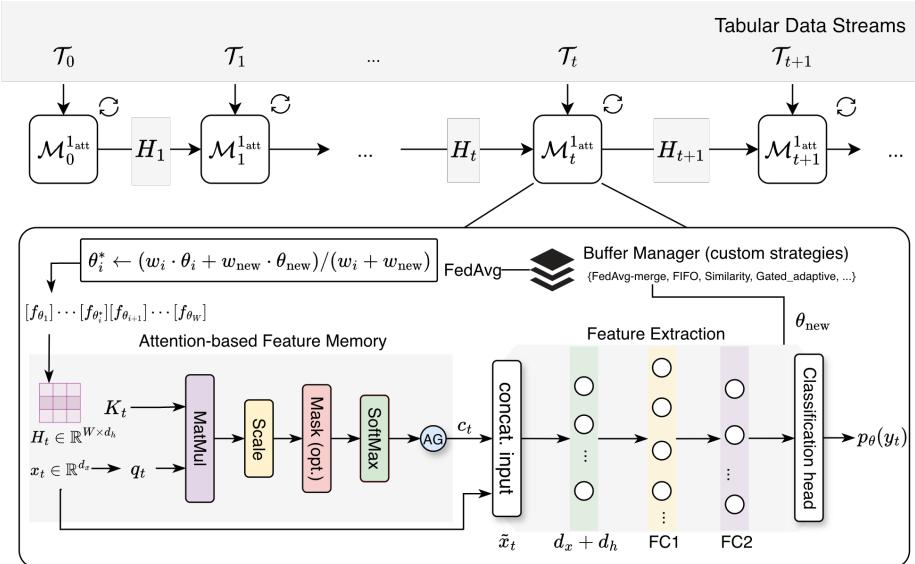  
Figure 1: AttenMLP architecture with custom buffer strategies. AttenMLP sequentially takes $\mathcal { T } _ { t }$ as raw input and outputs predictive performance $p _ { \theta } ( y _ { t } )$ .

We employ two strategies: (1) processing each task with an augmented MLP learner module $\mathcal { M } ^ { 1 _ { \mathrm { a t t } } }$ that incorporates limited historical context in a window size through a variant of scaled dot-product attention; and (2) maintaining the windowed historical model buffer with a fixed memory over time to handle the concept drifts and energy use.

Given the current input sample $x _ { t } \in \mathbb { R } ^ { d _ { x } }$ , the size of the latent feature representation $d _ { h }$ learned by the model, and a window size W, we denote $H _ { t } = [ h _ { t , 1 } , \ldots , h _ { t , W } ] ^ { \top } \stackrel { \mathbf { \lambda } } { \in } \mathbb { R } ^ { W \times d _ { h } }$ as the matrix, stacking the latent features in the window $W$ at time t. $h _ { t , j } \in \mathbb { R } ^ { d _ { h } }$ is the feature vector of the j-th most recent sample before $x _ { t }$ (with $j = 1$ being the most recent), precomputed from the buffer strategies via the historical learned models. With learnable maps $\hat { W _ { q } } \doteq \mathbb { R } ^ { d _ { h } \times d _ { x } }$ and $W _ { k } \in \mathbb { R } ^ { d _ { h } \times d _ { h } }$ (and biases $b _ { q } \in \mathbb { R } ^ { d _ { h } } , b _ { k } \in \mathbb { R } ^ { d _ { h } } )$ , AttenMLP forms

$$
q _ {t} = W _ {q} x _ {t} + b _ {q} \in \mathbb {R} ^ {d _ {h}},\tag{2}
$$

$$
K _ {t} = H _ {t} W _ {k} ^ {\top} + \mathbf {1} _ {W} b _ {k} ^ {\top} \in \mathbb {R} ^ {W \times d _ {h}},\tag{3}
$$

$$
s _ {t} = K _ {t} q _ {t} \in \mathbb {R} ^ {W},\tag{4}
$$

$$
\tilde {s} _ {t} = \frac {1}{\sqrt {d _ {h}}} s _ {t},\tag{5}
$$

$$
\alpha_ {t} = \mathrm{softmax} (\tilde {s} _ {t}) \in \mathbb {R} ^ {W},\tag{6}
$$

$$
c _ {t} = \alpha_ {t} ^ {\top} K _ {t} \in \mathbb {R} ^ {d _ {h}},\tag{7}
$$

where $\mathbf { 1 } _ { W } \in \mathbb { R } ^ { W }$ is the all-ones vector used to broadcast the bias $b _ { k }$ to all W rows. Here, $K _ { t , j } \in \mathbb { R } ^ { d _ { h } }$ is the j-th row of the corresponding key in the window. When the attention module is enabled, AttenMLP updates $h _ { t , j }$ from the historical model snapshots with custom buffer strategies.

This work considers four custom buffer strategies: a) first-in-first-out (FIFO), which performs unconditional replacement in arrival order; b) a similarity-based strategy that enforces diversity by removing the most similar buffered feature; c) a gated-adaptive strategy that conditionally replaces features based on an adaptive similarity threshold; and d) the FedAvg-merge strategy. It maintains the fixed-size buffer of evolving model prototypes by merging each new model snapshot into its most similar stored model via weighted federated averaging (McMahan et al., 2017), rather than storing it separately.

The attention-based feature memory context is computed as a weighted sum of the keys, $c _ { t } = \alpha _ { t } ^ { \top } K _ { t } \in$ $\mathbb { R } ^ { d _ { h } }$ . AttenMLP then concatenates the context with the current input, $\tilde { x } _ { t } = [ x _ { t } ; \dot { c _ { t } } ] \in \mathbb { R } ^ { d _ { x } + \tilde { d } _ { h } }$ , and feeds it to the feature extractor to obtain the latent representation $f _ { t } \bar { = } \phi _ { \theta } \grave { ( x _ { t } ) } \grave { \in } \mathbb { R } ^ { d _ { h } }$ , where $\phi _ { \theta } ( \cdot )$ is a two-layer MLP. Finally, the classifier outputs logits ${ \hat { y } } _ { t } = W _ { \mathrm { c l s } } f _ { t } + b _ { \mathrm { c l s } }$ , where $W _ { \mathrm { c l s } } \in \mathbb { R } ^ { C \times \bar { d } _ { h } }$ and $b _ { \mathrm { c l s } } \in \mathbb { R } ^ { \overline { { C } } }$ . The predictive distribution is given by $p _ { \theta } ( y _ { t } ) = \mathrm { s o f t m a x } ( \hat { y } _ { t } )$ , in which $y _ { t } \in \{ 1 , \cdots , C \}$ In the following sections, we detail the properties of the proposed attention-based feature memory design for achieving EECL over tabular data streams.

## 3.3 ATTENTION-BASED FEATURE MEMORY AND TIME COMPLEXITY

Unlike replay buffers that grow with the number of seen samples, our attention-based feature memory has constant memory complexity over time. At time $t ,$ the buffer stores a maximum W latent feature vectors of dimension $d _ { h } , \mathbf { \bar { i } . e . } , H _ { t } \in \mathbb { R } ^ { W \times d _ { h } }$ , which results in $\mathcal O ( W d _ { h } )$ memory per stream, independent of the stream length. In the batched implementation, each buffer holds W feature tensors, each of shape $[ B , d _ { h } ]$ ; hence, the runtime memory overhead is bounded by $\mathcal { O } ( B W d _ { h } )$ .

For a full forward pass with batch size B, the total computational efficiency of AttenMLP is the sum of (i) the query projection $\mathcal { O } ( B d _ { x } d _ { h } )$ , (ii) the key projection over the window $\mathcal { O } ( B W d _ { h } ^ { 2 } )$ (iii) attention score computation and aggregation $\mathcal { O } ( B \dot { W } \dot { d } _ { h } + B W + B W d _ { h } )$ , as well as (iv) the remaining ${ \mathrm { M L P } } ,$ consisting of two fully-connected layers $\mathrm { F C 1 } \colon ( d _ { x } + d _ { h } ) \to 5 1 2$ and FC2: $5 1 2  d _ { h }$ plus the classifier: $d _ { h }  C$ , which costs $\mathcal { O } ( B ( d _ { x } + d _ { h } ) \cdot 5 1 2 ) + B d _ { h } \cdot 5 1 2 + B d _ { h } C )$ . Overall, the forward-pass complexity is absorbed by $\mathcal { O } ( B d _ { h } ( d _ { x } + W d _ { h } ) )$ , where the attention time grows linearly with W and quadratically with $d _ { h }$ , due to the $d _ { h } ^ { 2 }$ key layer.

Therefore, the attention-based feature memory introduces two linear projections (query and key), adding $O ( d _ { x } d _ { h } + d _ { h } ^ { 2 } )$ parameters. The per-step attention computation scales as $\mathcal { O } ( B d _ { x } \dot { d } _ { h } \dot { + } B W d _ { h } ^ { 2 }$ + $B W d _ { h } )$ . At runtime, maintaining a sliding window of size $\dot { W }$ incurs $\mathcal { O } ( B W d _ { h } )$ memory to store the buffered features in batched form. Since the buffer size is capped by $\dot { W }$ and $d _ { h }$ , this yields constant memory over time with respect to the stream length.

## 3.4 CONVERGENCE ANALYSIS OF ATTENMLP

Let $\mathcal { A } ( x _ { t } , H _ { t } ; \theta _ { \mathrm { a t t } } ) : = c _ { t }$ denote the attention-based context, where $\theta _ { \mathrm { a t t } } = ( W _ { q } , b _ { q } , W _ { k } , b _ { k } )$ and $H _ { t }$ collects the past latent features at time t (with $c _ { t } = \mathbf { 0 }$ if the window is empty).

Lemma 3.1 (Bounded context vector). Under (A2) and (A3), there exists $B _ { c } > 0$ such that $\| c _ { t } \| _ { 2 } \leq$ $B _ { c } f o r a l l t .$

Lemma 3.2 (Smooth attention map). Under $( A I ) – ( A 3 )$ , the map $( x _ { t } , H _ { t } , \theta _ { \mathrm { a t t } } ) \mapsto \mathcal { A } ( x _ { t } , H _ { t } ; \theta _ { \mathrm { a t t } } )$ is continuously differentiable, and its Jacobian with respect to $\theta _ { \mathrm { a t t } }$ is bounded on the compact set $\kappa : =$ $\{ ( x _ { t } , H _ { t } , \mathring { \theta _ { \mathrm { a t t } } } ) : \| x _ { t } \| _ { 2 } \leq R _ { \mathcal { X } } , \| h _ { t , j } \| _ { 2 } \leq 1 , \ \| \theta _ { \mathrm { a t t } } \| _ { 2 } \leq R _ { \theta } \}$ . In particular, there exists $L _ { \mathrm { a t t } } > 0$ such that for all $( x _ { t } , H _ { t } )$ satisfying the above bounds and all $\theta _ { \mathrm { a t t } } ^ { ( 1 ) } , \theta _ { \mathrm { a t t } } ^ { ( 2 ) }$ with $\lVert \theta _ { \mathrm { a t t } } ^ { ( 1 ) } \rVert _ { 2 } , \lVert \theta _ { \mathrm { a t t } } ^ { ( 2 ) } \rVert _ { 2 } \leq R _ { \theta }$ $\| A ( x _ { t } , H _ { t } ; \theta _ { \mathrm { a t t } } ^ { ( 1 ) } ) - A ( x _ { t } , H _ { t } ; \theta _ { \mathrm { a t t } } ^ { ( 2 ) } ) \| _ { 2 } \leq L _ { \mathrm { a t t } } \| \theta _ { \mathrm { a t t } } ^ { ( 1 ) } - \theta _ { \mathrm { a t t } } ^ { ( 2 ) } \| _ { 2 }$

Correspondingly, the full network (logits) for a single sample can be formalized as

$$
f _ {\theta} (x _ {t}, H _ {t}) := W _ {\mathrm{cls}} \phi_ {\theta} \big ([ x _ {t}; \mathcal {A} (x _ {t}, H _ {t}; \theta_ {\mathrm{att}}) ] \big) + b _ {\mathrm{cls}},\tag{8}
$$

where $\phi _ { \theta }$ is the two-layer ReLU feature extractor. The per-sample cross-entropy loss is stated by

$$
\ell_ {t} (\theta) = \mathrm{CE} \big (f _ {\theta} (x _ {t}, H _ {t}), y _ {t} \big).\tag{9}
$$

Theorem 3.3 (Segment-wise regularity of empirical loss). Under $( A I ) – ( A 3 )$ , the empirical loss $\hat { L } _ { t } ( \theta )$ is (i) bounded below; and (ii) locally Lipschitz on the compact set $\{ \theta : \| \theta \| _ { 2 } \leq R _ { \theta } \}$ and differentiable almost everywhere on this set. Moreover, wherever $\nabla \hat { L } _ { t } ( \theta )$ exists, it is bounded on $\{ \theta : \| \theta \| _ { 2 } \leq R _ { \theta } \}$

Remark 3.4. For each fixed segment $\mathcal { T } _ { t } ,$ the attention-based feature memory yields a bounded mapping from a finite latent window, so the per-segment optimization problem is well-behaved for first-order methods under standard assumptions. Still, we do not claim convergence to a single global limit when the data distribution is non-stationary across t.

## 3.5 ENERGY EFFICIENCY ANALYSIS OF ATTENMLP

Consider that we use the attention-based feature memory in both training and inference.

For a fixed device and runtime configuration, we model the energy consumed per training step as an affine function of the step’s floating-point operations (FLOPs) $F _ { \mathrm { s t e p } } ,$ plus a bounded additive overhead $E _ { 0 }$ (Choi et al., 2013; Douwes & Serizel, 2024; Newkirk et al., 2025), i.e.,

$$
E _ {\text { step }} = \eta F _ {\text { step }} + E _ {0},\tag{10}
$$

where $\eta$ is a device-dependent energy-per-FLOP constant. We adopt the following assumptions:

(A4) On a fixed hardware platform (GPU/CPU) and under a fixed runtime configuration, there exist constants $0 < \eta _ { \mathrm { m i n } } \le \eta _ { \mathrm { m a x } }$ such that the energy-per-FLOP coefficient η satisfies $\eta \in [ \eta _ { \mathrm { m i n } } , \eta _ { \mathrm { m a x } } ]$ Equivalently, the FLOP-dependent part of the per-step energy is bounded as ηmin $F _ { \mathrm { s t e p } } \leq E _ { \mathrm { s t e p } } - E _ { 0 } \leq$ $\eta _ { \mathrm { { m a x } } } F _ { \mathrm { { s t e p } } }$

(A5) The additional system overhead per training step (e.g., warm-up overhead and cold-start data retrieval) is bounded by a constant $E _ { 0 }$ that is independent ofthe sample index and segment.

Lemma 3.5 (FLOP complexity per sample). For a single sample $x _ { t , i } ,$ the FLOP count of one forward-and-backward training step of AttenMLP satisfies $F _ { t r a i n } ( x _ { t , i } ) \leq K _ { a r c h } ( d _ { x } d _ { h } + W d _ { h } ^ { 2 } +$ $W d _ { h } + ( d _ { x } + d _ { h } ) \cdot 5 1 2 + 5 1 2 \cdot d _ { h } + { \dot { d } } _ { h } C )$ , for an architecture-dependent constant $K _ { a r c h } > 0$ that is independent of t and $n _ { t }$ . To simplify the expression, we drop the tiny pieces $W d _ { h } + W$ of the attention score computation and aggregation.

Theorem 3.6 (Per-segment energy complexity bound). Consider a segment $\mathcal { T } _ { t }$ with $n _ { t }$ training samples. Under $( A 4 ) { - } ( A 5 )$ and Lemma 3.5, the total training energy $E _ { t } ^ { t r a i { \bar { n } } }$ consumed by AttenMLP on this segment satisfies

$$
E _ {t} ^ {\text { train }} \leq n _ {t} \left(\eta_ {\max} F _ {\text { train }} (x _ {t, i}) + E _ {0} ^ {\text { train }}\right)\tag{11}
$$

Similarly, if $F _ { i n f e r }$ denotes the per-sample inference FLOPs (forward pass only $K _ { \mathrm { a r c h } } ^ { \mathrm { ( f w d ) } } < K _ { \mathrm { a r c h } } ) ,$ then the inference energy $E _ { t } ^ { \mathrm { i n f e r } }$ on a test set of size $n _ { t } ^ { t e s t }$ admits

$$
E _ {t} ^ {\text { infer }} \leq n _ {t} ^ {\text { test }} \left(\eta_ {\max} F _ {\text { infer }} (x _ {t, i}) + E _ {0} ^ {\text { infer }}\right),\tag{12}
$$

for a inference overhead constant $E _ { 0 } ^ { i n f e r } \geq 0 .$

Remark 3.7. The bounds above help interpret our empirical observations in two ways. First, on a fixed hardware platform and runtime configuration, the energy consumed by AttenMLP grows at most linearly with the total number of processed examples (and, for a fixed number of training epochs, linearly in the number of training steps), resulting in a predictable energy profile. Second, the attention-based feature memory introduces a controlled additional cost dominated by the key projection term $W d _ { h } ^ { 2 }$ , which remains tunable in our implementation since $W$ and $d _ { h }$ are configurable. Consequently, the measured energy (in Joules) is consistent with an energy complexity that is mostly linear in stream size.

## 4 ENERGY-ACCURACY TRADE-OFFS

In many optimization problems, objectives are inherently conflicting; for instance, improving the accuracy of an NN increases energy consumption or latency. A classical way to study such trade-offs is through Pareto front analysis (Giagkiozis & Fleming, 2014).

Our convergence and energy bounds naturally lead to a bi-objective viewpoint, where we jointly consider the online learner’s predictive performance and energy consumption. For a fixed segment $\mathcal { T } _ { t }$ , an AttenMLP configuration is often determined by its architecture parameters $B , d _ { h } , W$ and optimization budget $( \mathrm { e . g . }$ , number of iterations, learning-rate schedule). Each such configuration yields a pair $\left( E _ { t } \hat { ( } \theta ) , P _ { t } \hat { ( } \theta ) \right)$ , where $E _ { t } ( \theta )$ denotes the total energy consumed at time t and $P _ { t } ( \theta )$ denotes the resulting segment-wise model performance (e.g., balanced accuracy).

We say that a configuration $\theta ^ { ( 1 ) }$ Pareto-dominates $\theta ^ { ( 2 ) }$ if

$$
E _ {t} (\theta^ {(1)}) \leq E _ {t} (\theta^ {(2)}), \quad P _ {t} (\theta^ {(1)}) \geq P _ {t} (\theta^ {(2)}),\tag{13}
$$

with at least one strict inequality. The Pareto set $\mathcal { P } _ { t } : = \ \{ \theta : \exists \theta ^ { \prime } \ \mathrm { s . t . } \ E _ { t } ( \theta ^ { \prime } ) \ \leq E _ { t } ( \theta ) , \ P _ { t } ( \theta ^ { \prime } ) \ \geq$ $P _ { t } ( \theta ) \}$ , which collects all Pareto-efficient configurations, and its image in the energy-performance plane forms the Pareto frontier. To quantitively measure the trade-offs, we define an efficiency metric as the normalized Euclidean distance to the ideal performance–energy operating point, which is given by

$$
\mathrm{Efficiency} = 1 - \frac {\sqrt {(1 - P (\theta)) ^ {2} + (\tilde {E} (\theta)) ^ {2}}}{\sqrt {2}},\tag{14}
$$

where $\tilde { E } ( \theta ) \in [ 0 , 1 ]$ denotes the normalized energy consumption. This metric jointly captures predictive performance and energy consumption, rewarding models that achieve a balanced trade-off between accuracy and energy consumption.

Intuitively, on each segment $\mathcal { T } _ { t } ,$ our smoothness and Lipschitz-gradient assumptions imply that stochastic first-order methods require on the order of $1 / \varepsilon ^ { 2 }$ iterations to reach an ε-stationary point of the empirical loss $\hat { L } _ { t } ( \theta )$ in expectation. Each iteration has a bounded computational cost proportional to $d _ { x } \dot { d _ { h } } + W d _ { h } ^ { 2 } + \dot { W } \dot { d _ { h } } + ( \dot { d _ { x } } + 2 d _ { h } ) 5 1 2 + d _ { h } C$ (Lemma 3.5), and our energy model (Theorem 3.6) shows that energy is proportional to this cost up to device-dependent constants.

## 5 EXPERIMENTS

Setup and Configuration. We conducted extensive experiments on an Alienware desktop equipped with Intel(R) Core(TM) i9-10900KF CPU@3.70GHz CPU model, 32GiB Comet Lake PCH Shared SRAM memory, and one NVIDIA GeForce RTX 2080 Ti GPU model. To measure energy consumption, we instrument our CL pipeline with the Python package codecarbon (Courty et al., 2024) that estimates and tracks carbon emissions from the device.

Datasets and Baselines. We evaluate our method on real-world concept drift benchmarks using River’s INSECTS datasets1 , which are chosen to represent challenging drift scenarios with different patterns (Souza et al., 2020). We consider both abrupt and incremental concept drift settings to assess model robustness under different drift dynamics. We compare our AttenMLP model against a comprehensive set of nine recent SOTA models for tabular classification, covering three distinct model categories: 1) foundation models: TabPFNv2 (Hollmann et al., 2025); 2) deep NN baselines: RealMLP (Holzmüller et al., 2024), ModernNCA (Ye et al., 2024), TabM (Gorishniy et al., 2024), TabR (Gorishniy et al., 2023), and MLP (Taud & Mas, 2017); and 3) GBDTs: CatBoost (Prokhorenkova et al., 2018), XGBoost (Chen & Guestrin, 2016), and LightGBM (Ke et al., 2017).

Evaluation Protocol. A crucial consideration for the evaluation is that our selected baselines were primarily developed for static, independent, and identically distributed data. While an ideal comparison would involve creating a dedicated CL variant of each baseline, e.g., equipped with specialized components for memory and catastrophic forgetting mitigation, such an undertaking is outside the scope of this work. To establish a methodologically sound comparison, we standardize the data flow and retrain the baseline models per arriving segment without using attention-based feature memory context. With the segmental mode, each segment is split into 85% training and 15% evaluation using a stratified split when feasible. The training epoch and learning rate are set to epochs = 500, lr = 0.001, and batch size is 256. All models are evaluated using six metrics: balanced accuracy, log-loss, total energy consumed, and execution time. All reported statistics are computed from the experimentally collected results with a random seed of 42.

## 5.1 ABLATION STUDY: IMPACT OF ATTENTION, $d _ { h } , W .$ , AND BUFFER STRATEGY CHOICES

Attention and buffer strategy choices. We first ablated the core components, i.e., the attention module and custom buffer strategies, on the abrupt-concept-drift dataset to evaluate their impacts on AttenMLP performance and energy consumption.

Figure 2 compares the performance of AttenMLP with and without the attention module. The ablated results indicate that the attention mechanism (with fedavg-merge buffer strategy) contributes significantly to performance gains, albeit with higher energy expenditure due to its addi tional computational overhead. Specifically, compared to the non-attention baseline, the median balanced accuracy improves by 15.35% (from 0.3504 to 0.4042). Meanwhile, the final accuracy increases by 43.34% (from 0.4386 to 0.6287), while the energy overhead increases by 4.93 kJ.

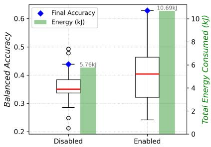

Figure 3 presents that four buffer strategies exhibit comparable energy consumption when the attention-based feature memory is enabled, while differing in balanced accuracy. The similarity-based strategy achieves the highest final accuracy (0.6479) compared to FIFO (0.6059), gatedadaptive (0.6217), and fedavg-merge (0.6287) strategies. That is, under a fixed concept-drift type, the performance of the proposed incremental learner can be improved by incorporating a sophisticated buffer strategy.

Impact of $d _ { h }$ and W under different concept drifts. We ablated the window size W and hidden dimensions $d _ { h }$ under abrupt-concept-drift and incremental-concept-drift datasets, as depicted in Figure 4.

Figure 2: Attention usage comparison.  
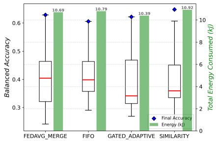  
Figure 3: Buffer strategy comparison.

Figures 4a and 4c compare different hidden dimension sizes under a fixed window size $( W = 1 5 )$ . On one hand,

the results show that increasing $d _ { h }$ consistently improves final accuracy under both types of concept drift. Final accuracy rises steadily from $d _ { h } = 1 2 8$ to 1024 in the abrupt-drift setting and from $d _ { h } = 6 4$ to 1024 in the incremental-drift setting across most buffer strategies. On the other hand, under fixed $d _ { h }$ and W, buffer strategy performance varies with the drift type. FIFO performs best under abrupt drifts, the gated-adaptive strategy excels under incremental drifts (at $d _ { h } = 1 0 2 4 )$ , while the similarity-based strategy performs well for incremental concept drifts but degrades under abrupt concept shifts.

Figures 4b and 4d show that, with a fixed $d _ { h } = 1 0 2 4$ , the total energy consumption increases gradually as W grows from 1 to 25. In contrast, larger window sizes do not necessarily provide more informative historical context. This is because, beyond a small number of representative model snapshots, additional buffered models tend to be redundant in representation space, especially under incremental or abrupt concept drifts.

Therefore, the attention-based feature memory design with custom buffer strategies substantially improves the learner’s predictive performance while effectively influencing the energy consumption under non-stationary distributions.

## 5.2 EVALUATION UNDER DIFFERENT CONCEPT DRIFTS

Figure 5 compares against the baseline models with the dynamic performance and energy consumed in arrival sequences, where $\mathtt { A t t e n M L P }$ uses fedavg-merge and similarity-based buffer strategy with $d _ { h } = 1 0 2 4 , W = 1$ for abrupt and incremental concept drifts, respectively.

Figure 5a shows that CatBoost and TabPFNv2 experience a noticeable performance drop under the abrupt concept drift, while AttenMLP (with fedavg-merge buffer strategy) adapts to the abrupt drifts. AttenMLP experiences an immediate accuracy drop following abrupt drifts but quickly recovers in subsequent segments by leveraging latent features stored in the attention-based buffer, despite starting from a lower accuracy compared to advanced baselines. For instance, segment 16 shows a significant drop in balanced accuracy (0.3658); however, the accuracy recovers to 0.5885 at segment 17. AttenMLP (0.6532) outperforms MLP (0.5132), RealMLP (0.4225) in the final accuracy gains, while it is comparable with TabR (0.6907), TabM (0.6874), XGBoost (0.6770), ModernCNA (0.6599), and LightGBM (0.6560). Figure 5c shows that under incremental concept drifts, TabPFNv2 achieves the highest accuracy (0.7151), followed by TabM (0.6814), CatBoost (0.6701), LightGBM (0.6613), and $\mathtt { A t t e n M L P }$ (0.6534), even without CL mechanisms. Equipped with the attention-based feature memory mechanism, AttenMLP consistently outperforms RealMLP and MLP across all evaluated settings.

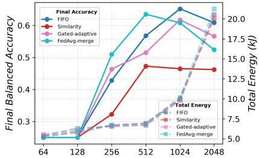  
(a) $d _ { h }$ , $W = 1 5 ,$ abrupt concept drifts.

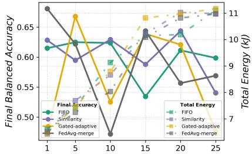  
(b) W, $d _ { h } = 1 0 2 4 .$ abrupt concept drifts.

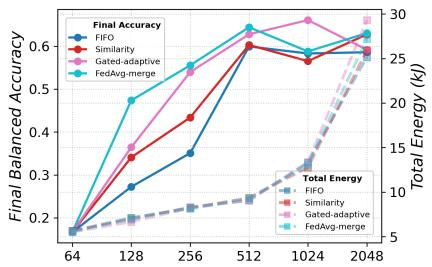

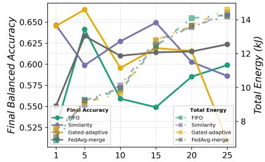  
(c) $d _ { h } , W = 1 5 .$ , incremental concept drifts. (d) $V , d _ { h } = 1 0 2 4$ , incremental concept drifts. Figure 4: Impact of $d _ { h }$ and $W$ under different concept drifts.

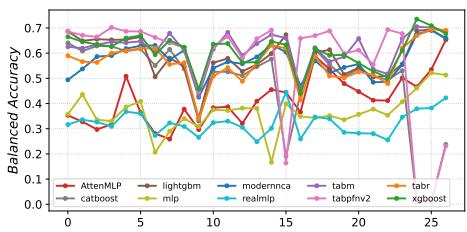  
(a) Balanced Accuracy, abrupt drift.

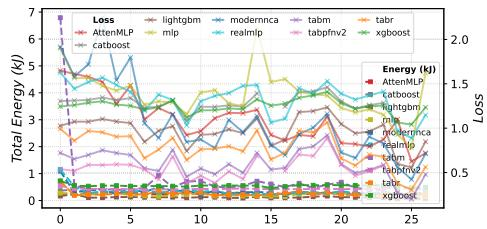  
(b) Energy consumed and loss, abrupt drift.

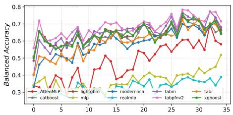  
(c) Balanced Accuracy, incremental drift.

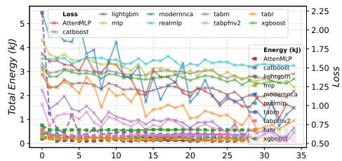  
(d) Energy consumed and loss, incremental drift.  
Figure 5: Overview of the model performance and energy consumption under different concept drifts.

Figures 5b and 5d present that TabM incurs the highest energy cost in the first segment under both types of concept drifts. Although LightGBM and XGBoost achieve relatively high accuracy, their loss values remain consistently higher. This reflects conservative and less well-calibrated probability estimates rather than misclassification errors. AttenMLP and other NNs exhibit progressively lower loss values, as their use of softmax-based outputs and continuous latent representations enables better probability calibration and more confident predictions. Under both concept drift scenarios, LightGBM exhibits the lowest energy consumption across all segments.

Table 1: Energy-accuracy trade-off analysis.

<table><tr><td>Data</td><td>Method</td><td>Final Acc</td><td>Final Loss</td><td>Energy (J)</td><td>Efficiency</td><td>Pareto?</td></tr><tr><td rowspan="10">Abrupt concept drift</td><td>LightGBM</td><td>0.6560</td><td>0.8480</td><td>3165.13</td><td>0.7568</td><td>✓</td></tr><tr><td>TabR</td><td>0.6907</td><td>0.5618</td><td>6983.89</td><td>0.7330</td><td>✓</td></tr><tr><td>ModernNCA</td><td>0.6599</td><td>0.7119</td><td>8813.27</td><td>0.6696</td><td>✘</td></tr><tr><td>MLP</td><td>0.5132</td><td>1.6231</td><td>5625.17</td><td>0.6419</td><td>✘</td></tr><tr><td>RealMLP</td><td>0.4225</td><td>1.1474</td><td>9140.99</td><td>0.5264</td><td>✘</td></tr><tr><td>XGBoost</td><td>0.6770</td><td>1.2343</td><td>14749.36</td><td>0.4822</td><td>✘</td></tr><tr><td>CatBoost</td><td>0.2378</td><td>NaN</td><td>7279.81</td><td>0.4363</td><td>✘</td></tr><tr><td>TabPFNv2</td><td>0.2317</td><td>NaN</td><td>11750.05</td><td>0.3567</td><td>✘</td></tr><tr><td>TabM</td><td>0.6874</td><td>0.4786</td><td>20789.53</td><td>0.2592</td><td>✘</td></tr><tr><td>AttenMLP</td><td>0.6532</td><td>0.7195</td><td>6881.35</td><td>0.7130</td><td>✘</td></tr><tr><td rowspan="10">Incremental concept drift</td><td>LightGBM</td><td>0.6613</td><td>1.1930</td><td>4120.82</td><td>0.7605</td><td>✓</td></tr><tr><td>TabR</td><td>0.6403</td><td>0.8010</td><td>7507.23</td><td>0.7089</td><td>✘</td></tr><tr><td>ModernNCA</td><td>0.6462</td><td>0.9696</td><td>8966.41</td><td>0.6781</td><td>✘</td></tr><tr><td>CatBoost</td><td>0.6701</td><td>1.4211</td><td>10163.78</td><td>0.6562</td><td>✓</td></tr><tr><td>MLP</td><td>0.5183</td><td>1.2442</td><td>6856.02</td><td>0.6407</td><td>✘</td></tr><tr><td>TabPFNv2</td><td>0.7151</td><td>0.6486</td><td>12049.59</td><td>0.6122</td><td>✓</td></tr><tr><td>RealMLP</td><td>0.3891</td><td>1.5281</td><td>9472.86</td><td>0.5136</td><td>✘</td></tr><tr><td>XGBoost</td><td>0.6425</td><td>1.3542</td><td>19844.90</td><td>0.2959</td><td>✘</td></tr><tr><td>TabM</td><td>0.6814</td><td>0.7064</td><td>21041.62</td><td>0.2579</td><td>✘</td></tr><tr><td>AttenMLP</td><td>0.6534</td><td>0.9701</td><td>8034.49</td><td>0.7053</td><td>✘</td></tr></table>

Table 1 shows that under both concept drifts, AttenMLP achieves the third-highest global efficiency, after LightGBM and TabR, although none are Pareto-optimal in the front analysis between final accuracy and total energy consumption. For abrupt drifts, AttenMLP (0.6532, 6.88kJ) consumes 1.4% less energy than TabR (0.6907, 7.51kJ), with a 0.0375 drop in accuracy. Under incremental drifts, AttenMLP (0.6534, 8.03kJ) reduces energy consumption by up to 33.3% compared to TabPFNv2 (0.7151, 12.05kJ), at a 0.062 accuracy drop.

However, after excluding LightGBM, AttenMLP consistently lies on the Pareto frontier and ranks among the top-performing NN baselines in terms of the energy–accuracy trade-off across both scenarios. In the abrupt drift scenario, AttenMLP (0.7479) achieves the second-highest efficiency after TabR (0.7723), while in the incremental drift scenario, AttenMLP attains the highest efficiency at 0.7480. TabR is ranked second at 0.7436.

These findings suggest promising directions for future work, including improved buffer management, integration of advanced model architectures, and optimized configurations to better balance energy and performance.

## 6 CONCLUSION

This paper addresses the critical gap of EECL on tabular data streams by introducing a novel incremental MLP model called AttenMLP. It employs a novel attention-based feature replay with context retrieval and custom buffer updates, integrated into a minibatch training loop for streaming tabular learning. Experiments show that AttenMLP matches the comparable accuracy of baselines under no replay while substantially reducing energy costs. AttenMLP achieves up to 33.3% energy reduction compared to TabPFNv2, while sacrificing 0.062 final accuracy. Ranked third in terms of global efficiency, AttenMLP follows LightGBM and TabR, while remaining competitive among NN–based models. When compared only against NN baselines, AttenMLP lies on the Pareto frontier and ranks among the top-performing models with respect to the energy–accuracy trade-off.

Limitations and Future Work. Despite these exciting findings, AttenMLP currently treats baselines on River’s Insets benchmarks in an experimental setting. A promising next step is to compare the method with up-to-date models on real-life lifelong settings and broader validation on standard stream datasets, thereby enriching the benchmarks with comprehensive CL strategies. Beyond that, building a standardized energy reporting system with a hardware-level setup could help for a more robust evaluation for EECL on tabular streams. These would shed light on the influence of alternative CL strategies for SOTA baselines and EECL.

## REFERENCES

Rahaf Aljundi, Francesca Babiloni, Mohamed Elhoseiny, Marcus Rohrbach, and Tinne Tuytelaars. Memory aware synapses: Learning what (not) to forget. In Proceedings ofthe European conference on computer vision (ECCV), pp. 139–154, 2018.

Fatemeh Amrollahi, Supreeth P Shashikumar, Andre L Holder, and Shamim Nemati. Leveraging clinical data across healthcare institutions for continual learning of predictive risk models. Scientific reports, 12(1):8380, 2022.

Sercan Ö Arik and Tomas Pfister. Tabnet: Attentive interpretable tabular learning. In Proceedings of the AAAI conference on artificial intelligence, volume 35 (8), pp. 6679–6687, 2021.

Prashant Shivaram Bhat, Bahram Zonooz, and Elahe Arani. Consistency is the key to further mitigating catastrophic forgetting in continual learning. In Conference on Lifelong Learning Agents, pp. 1195–1212. PMLR, 2022.

Albert Bifet, Geoff Holmes, and Bernhard Pfahringer. Leveraging bagging for evolving data streams. In Joint European conference on machine learning and knowledge discovery in databases, pp. 135–150. Springer, 2010.

Antoine Bordes, Seyda Ertekin, Jason Weston, and Léon Bottou. Fast kernel classifiers with online and active learning. Journal ofmachine learning research, 6(Sep):1579–1619, 2005.

Vadim Borisov, Tobias Leemann, Kathrin Seßler, Johannes Haug, Martin Pawelczyk, and Gjergji Kasneci. Deep neural networks and tabular data: A survey. IEEE transactions on neural networks and learning systems, 35(6):7499–7519, 2022.

Gert Cauwenberghs and Tomaso Poggio. Incremental and decremental support vector machine learning. Advances in neural information processing systems, 13, 2000.

Zhuoqing Chang, Shubo Liu, Xingxing Xiong, Zhaohui Cai, and Guoqing Tu. A survey of recent advances in edge-computing-powered artificial intelligence of things. IEEE Internet of Things Journal, 8(18):13849–13875, 2021.

Arslan Chaudhry, Marc’Aurelio Ranzato, Marcus Rohrbach, and Mohamed Elhoseiny. Efficient lifelong learning with a-gem. arXiv preprint arXiv:1812.00420, 2018.

Vivek Chavan, Paul Koch, Marian Schlüter, and Clemens Briese. Towards realistic evaluation of industrial continual learning scenarios with an emphasis on energy consumption and computational footprint. In Proceedings of the IEEE/CVF International Conference on Computer Vision, pp. 11506–11518, 2023.

Tianqi Chen and Carlos Guestrin. Xgboost: A scalable tree boosting system. In Proceedings of the 22nd ACM SIGKDD International Conference on Knowledge Discovery and Data Mining, KDD ’16, pp. 785–794, New York, NY, USA, 2016. Association for Computing Machinery. ISBN 9781450342322. doi: 10.1145/2939672.2939785.

Jee Whan Choi, Daniel Bedard, Robert Fowler, and Richard Vuduc. A roofline model of energy. In 2013 IEEE 27th International Symposium on Parallel and Distributed Processing, pp. 661–672. IEEE, 2013.

Corinna Cortes and Vladimir Vapnik. Support-vector networks. Machine learning, 20(3):273–297, 1995.

Benoit Courty, Victor Schmidt, Sasha Luccioni, Goyal-Kamal, MarionCoutarel, Boris Feld, Jérémy Lecourt, LiamConnell, Amine Saboni, Inimaz, supatomic, Mathilde Léval, Luis Blanche, Alexis Cruveiller, ouminasara, Franklin Zhao, Aditya Joshi, Alexis Bogroff, Hugues de Lavoreille, Niko Laskaris, Edoardo Abati, Douglas Blank, Ziyao Wang, Armin Catovic, Marc Alencon, Michał St˛echły, Christian Bauer, Lucas Otávio N. de Araújo, JPW, and MinervaBooks. mlco2/codecarbon: v2.4.1, May 2024. URL https://doi.org/10.5281/zenodo.11171501.

Thomas Cover and Peter Hart. Nearest neighbor pattern classification. IEEE transactions on information theory, 13(1):21–27, 1967.

David R Cox. The regression analysis of binary sequences. Journal of the Royal Statistical Society Series B: Statistical Methodology, 20(2):215–232, 1958.

Matthias De Lange, Rahaf Aljundi, Marc Masana, Sarah Parisot, Xu Jia, Aleš Leonardis, Gregory Slabaugh, and Tinne Tuytelaars. A continual learning survey: Defying forgetting in classification tasks. IEEE transactions on pattern analysis and machine intelligence, 44(7):3366–3385, 2021.

Pedro Domingos and Geoff Hulten. Mining high-speed data streams. In Proceedings of the sixth ACM SIGKDD international conference on Knowledge discovery and data mining, pp. 71–80, 2000.

Constance Douwes and Romain Serizel. From computation to consumption: Exploring the compute-energy link for training and testing neural networks for sed systems. arXiv preprint arXiv:2409.05080, 2024.

Ioannis Giagkiozis and Peter J Fleming. Pareto front estimation for decision making. Evolutionary computation, 22(4):651–678, 2014.

Heitor M Gomes, Albert Bifet, Jesse Read, Jean Paul Barddal, Fabrício Enembreck, Bernhard Pfharinger, Geoff Holmes, and Talel Abdessalem. Adaptive random forests for evolving data stream classification. Machine Learning, 106(9):1469–1495, 2017.

Yury Gorishniy, Ivan Rubachev, Valentin Khrulkov, and Artem Babenko. Revisiting deep learning models for tabular data. Advances in neural information processing systems, 34:18932–18943, 2021.

Yury Gorishniy, Ivan Rubachev, Nikolay Kartashev, Daniil Shlenskii, Akim Kotelnikov, and Artem Babenko. Tabr: Tabular deep learning meets nearest neighbors in 2023. arXiv preprint arXiv:2307.14338, 2023.

Yury Gorishniy, Akim Kotelnikov, and Artem Babenko. Tabm: Advancing tabular deep learning with parameter-efficient ensembling. arXiv preprint arXiv:2410.24210, 2024.

Lucía Bouza Heguerte, Aurélie Bugeau, and Loïc Lannelongue. How to estimate carbon footprint when training deep learning models? a guide and review. Environmental Research Communications, 5(11):115014, 2023. doi: 10.1088/2515-7620/acf81b.

Peter Henderson, Jierui Hu, Joshua Romoff, Emma Brunskill, Dan Jurafsky, and Joelle Pineau. Towards the systematic reporting of the energy and carbon footprints of machine learning. In Proceedings of the Workshop on Challenges in Deploying and monitoring Machine Learning Systems (EMNLP), 2020. arXiv:2002.05651.

T Ryan Hoens, Robi Polikar, and Nitesh V Chawla. Learning from streaming data with concept drift and imbalance: an overview. Progress in Artificial Intelligence, 1(1):89–101, 2012.

Noah Hollmann, Samuel Müller, Lennart Purucker, Arjun Krishnakumar, Max Körfer, Shi Bin Hoo, Robin Tibor Schirrmeister, and Frank Hutter. Accurate predictions on small data with a tabular foundation model. Nature, 637(8045):319–326, 2025.

David Holzmüller, Léo Grinsztajn, and Ingo Steinwart. Better by default: Strong pre-tuned mlps and boosted trees on tabular data. Advances in Neural Information Processing Systems, 37: 26577–26658, 2024.

Arlind Kadra, Marius Lindauer, Frank Hutter, and Josif Grabocka. Well-tuned simple nets excel on tabular datasets. Advances in neural information processing systems, 34:23928–23941, 2021.

Guolin Ke, Qi Meng, Thomas Finley, Taifeng Wang, Wei Chen, Weidong Ma, Qiwei Ye, and Tie-Yan Liu. Lightgbm: A highly efficient gradient boosting decision tree. Advances in neural information processing systems, 30, 2017.

Zixuan Ke, Bing Liu, Nianzu Ma, Hu Xu, and Lei Shu. Achieving forgetting prevention and knowledge transfer in continual learning. Advances in Neural Information Processing Systems, 34: 22443–22456, 2021.

Ronald Kemker, Marc McClure, Angelina Abitino, Tyler Hayes, and Christopher Kanan. Measuring catastrophic forgetting in neural networks. In Proceedings of the AAAI conference on artificial intelligence, volume 32 (1), 2018.

James Kirkpatrick, Razvan Pascanu, Neil Rabinowitz, Joel Veness, Guillaume Desjardins, Andrei A Rusu, Kieran Milan, John Quan, Tiago Ramalho, Agnieszka Grabska-Barwinska, et al. Overcoming catastrophic forgetting in neural networks. Proceedings ofthe national academy ofsciences, 114 (13):3521–3526, 2017.

Jyrki Kivinen, Alexander J Smola, and Robert C Williamson. Online learning with kernels. IEEE transactions on signal processing, 52(8):2165–2176, 2004.

Cecilia S Lee and Aaron Y Lee. Clinical applications of continual learning machine learning. The Lancet Digital Health, 2(6):e279–e281, 2020.

Ao Li, Chong Zhang, Fu Xiao, Cheng Fan, Yang Deng, and Dan Wang. Large-scale comparison and demonstration of continual learning for adaptive data-driven building energy prediction. Applied Energy, 347:121481, 2023.

Xiaodi Li, Dingcheng Li, Rujun Gao, Mahmoud Zamani, and Latifur Khan. Lsebmcl: A latent space energy-based model for continual learning. In 2025 International Conference on Artificial Intelligence in Information and Communication (ICAIIC), pp. 0690–0695. IEEE, 2025a.

Xilai Li, Yingbo Zhou, Tianfu Wu, Richard Socher, and Caiming Xiong. Learn to grow: A continual structure learning framework for overcoming catastrophic forgetting. In International conference on machine learning, pp. 3925–3934. PMLR, 2019.

Yichen Li, Haozhao Wang, Wenchao Xu, Tianzhe Xiao, Hong Liu, Minzhu Tu, Yuying Wang, Xin Yang, Rui Zhang, Shui Yu, et al. Unleashing the power of continual learning on non-centralized devices: A survey. IEEE Communications Surveys & Tutorials, 2025b.

Yujie Li, Xin Yang, Hao Wang, Xiangkun Wang, and Tianrui Li. Learning to prompt knowledge transfer for open-world continual learning. In Proceedings ofthe AAAI Conference on Artificial Intelligence, volume 38 (12), pp. 13700–13708, 2024.

Zhizhong Li and Derek Hoiem. Learning without forgetting. IEEE Transactions on Pattern Analysis and Machine Intelligence, 40(12):2935–2947, 2017.

Wei-Yin Loh. Classification and regression trees. Wiley interdisciplinary reviews: data mining and knowledge discovery, 1(1):14–23, 2011.

David Lopez-Paz and Marc’Aurelio Ranzato. Gradient episodic memory for continual learning. Advances in neural information processing systems, 30, 2017.

Brendan McMahan, Eider Moore, Daniel Ramage, Seth Hampson, and Blaise Aguera y Arcas. Communication-efficient learning of deep networks from decentralized data. In Artificial intelligence and statistics, pp. 1273–1282. PMLR, 2017.

Jacob Montiel, Rory Mitchell, Eibe Frank, Bernhard Pfahringer, Talel Abdessalem, and Albert Bifet. Adaptive xgboost for evolving data streams. In 2020 international joint conference on neural networks (IJCNN), pp. 1–8. IEEE, 2020.

Alex C Newkirk, Jared Fernandez, Jonathan Koomey, Imran Latif, Emma Strubell, Arman Shehabi, and Constantine Samaras. Empirically-calibrated h100 node power models for reducing uncertainty in ai training energy estimation. arXiv preprint arXiv:2506.14551, 2025.

Nikunj C Oza and Stuart J Russell. Online bagging and boosting. In International workshop on artificial intelligence and statistics, pp. 229–236. PMLR, 2001.

German I Parisi, Ronald Kemker, Jose L Part, Christopher Kanan, and Stefan Wermter. Continual lifelong learning with neural networks: A review. Neural networks, 113:54–71, 2019.

F. Pedregosa, G. Varoquaux, A. Gramfort, V. Michel, B. Thirion, O. Grisel, M. Blondel, P. Prettenhofer, R. Weiss, V. Dubourg, J. Vanderplas, A. Passos, D. Cournapeau, M. Brucher, M. Perrot, and E. Duchesnay. Scikit-learn: Machine learning in Python. Journal ofMachine Learning Research, 12:2825–2830, 2011.

Liudmila Prokhorenkova, Gleb Gusev, Aleksandr Vorobev, Anna Veronika Dorogush, and Andrey Gulin. Catboost: unbiased boosting with categorical features. Advances in neural information processing systems, 31, 2018.

Reshawn Ramjattan, Daniele Atzeni, and Daniele Mazzei. Comparative evaluation of continual learning methods in financial and industrial time-series data. In 2024 International Joint Conference on Neural Networks (IJCNN), pp. 1–7. IEEE, 2024.

Sylvestre-Alvise Rebuffi, Alexander Kolesnikov, Georg Sperl, and Christoph H Lampert. icarl: Incremental classifier and representation learning. In Proceedings of the IEEE conference on Computer Vision and Pattern Recognition, pp. 2001–2010, 2017.

Andrei A Rusu, Neil C Rabinowitz, Guillaume Desjardins, Hubert Soyer, James Kirkpatrick, Koray Kavukcuoglu, Razvan Pascanu, and Raia Hadsell. Progressive neural networks. arXiv preprint arXiv:1606.04671, 2016.

Haizhou Shi, Zihao Xu, Hengyi Wang, Weiyi Qin, Wenyuan Wang, Yibin Wang, Zifeng Wang, Sayna Ebrahimi, and Hao Wang. Continual learning of large language models: A comprehensive survey. ACM Computing Surveys, 58(5):1–42, 2025.

Xinyu Shi, Jianhao Ding, Zecheng Hao, and Zhaofei Yu. Towards energy efficient spiking neural networks: An unstructured pruning framework. In The Twelfth International Conference on Learning Representations, 2024.

H. Shin, J. K. Lee, J. Kim, J. Kim, and S. Kim. Continual learning with deep generative replay. In Advances in Neural Information Processing Systems, pp. 2990–2999, 2017.

Gowthami Somepalli, Micah Goldblum, Avi Schwarzschild, C Bayan Bruss, and Tom Goldstein. Saint: Improved neural networks for tabular data via row attention and contrastive pre-training. arXiv preprint arXiv:2106.01342, 2021.

Vinicius MA Souza, Denis M dos Reis, Andre G Maletzke, and Gustavo EAPA Batista. Challenges in benchmarking stream learning algorithms with real-world data. Data Mining and Knowledge Discovery, 34(6):1805–1858, 2020.

Hind Taud and Jean-Franccois Mas. Multilayer perceptron (mlp). In Geomatic approaches for modeling land change scenarios, pp. 451–455. Springer, 2017.

Tomaso Trinci, Simone Magistri, Roberto Verdecchia, and Andrew D. Bagdanov. How green is continual learning, really? analyzing the energy consumption in continual training of vision foundation models. arXiv preprint arXiv:2409.18664, 2024. Accepted to GreenFOMO Workshop at ECCV 2024.

Ashish Vaswani, Noam Shazeer, Niki Parmar, Jakob Uszkoreit, Llion Jones, Aidan N Gomez, Łukasz Kaiser, and Illia Polosukhin. Attention is all you need. Advances in neural information processing systems, 30, 2017.

Liyuan Wang, Xingxing Zhang, Hang Su, and Jun Zhu. A comprehensive survey of continual learning: Theory, method and application. IEEE Transactions on Pattern Analysis and Machine Intelligence, 46(8):5362–5383, 2024.

Mingqing Xiao, Qingyan Meng, Zongpeng Zhang, Di He, and Zhouchen Lin. Hebbian learning based orthogonal projection for continual learning of spiking neural networks. arXiv preprint arXiv:2402.11984, 2024.

Ju Xu, Jin Ma, and Zhanxing Zhu. Bayesian optimized continual learning with attention mechanism. arXiv preprint arXiv:1905.03980, 2019.

Han-Jia Ye, Huai-Hong Yin, and De-Chuan Zhan. Modern neighborhood components analysis: A deep tabular baseline two decades later. arXiv e-prints, pp. arXiv–2407, 2024.

Guri Zabërgja, Arlind Kadra, Christian MM Frey, and Josif Grabocka. Is deep learning finally better than decision trees on tabular data? arXiv preprint arXiv:2402.03970, 2024.

Friedemann Zenke, Ben Poole, and Surya Ganguli. Continual learning through synaptic intelligence. In International conference on machine learning, pp. 3987–3995. PMLR, 2017.