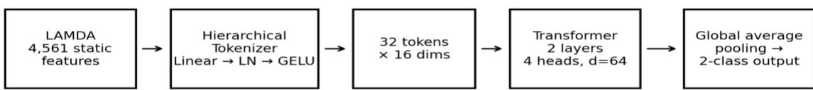
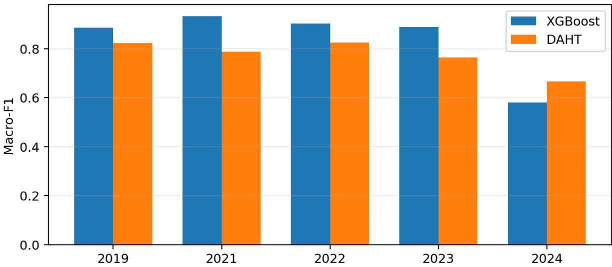
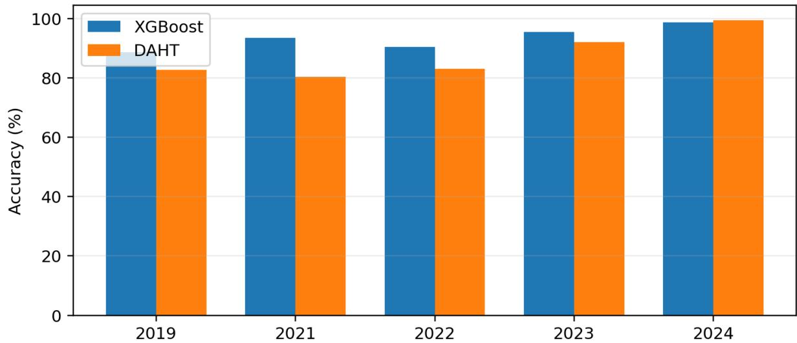
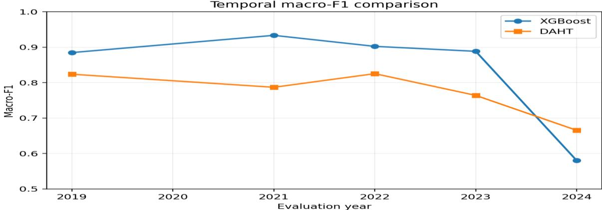
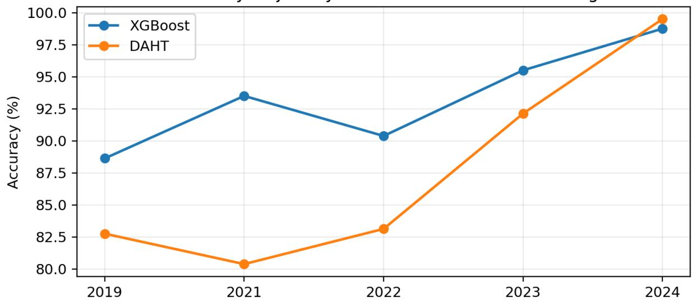
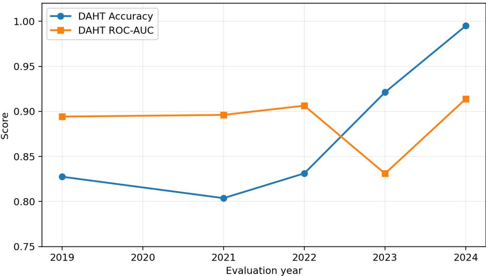
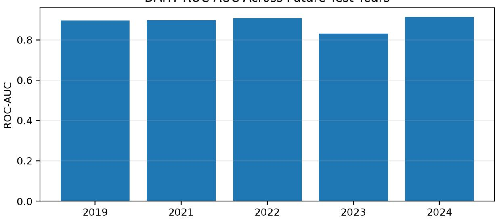

# DAHT: A Domain-Aware Hierarchical Transformer for Longitudinal Android Malware Detection under Concept Drift

Ms.L.Catherine Lemoria1,Dr.T. Miranda Lakshmi2

¹ Research Scholar

PG & Research Department of Computer Science and AI, St. Joseph’s College of Arts & Science, (Autonomous), Cuddalore – 607001, Affiliated to Annamalai University, TamilNadu, India. Email: clemoria.phdcs@sjctnc.edu.in

2Associate Professor 2Associate Professor

PG & Research Department of Computer Science and AI, St. Joseph’s College of Arts & Science, (Autonomous), Cuddalore – 607001, Affiliated to Annamalai University, TamilNadu, India. Email: miranda@sjctnc.edu.in

Abstract. Android malware detection has achieved strong results on many benchmark datasets, but those results are often obtained from random train-test splits that mix applications from different periods. Such a split is useful for measuring ordinar predictive generalization, but it does not answer a practical question: how well does a detector trained on older applications work when it encounters applications released later? This paper studies that question through a Domain-Aware Hierarchical Transformer (DAHT) for static Android malware detection. DAHT converts a 4,561-dimensional feature vector into 32 learned tokens, projects them into a 64-dimensional embedding space, and processes them with a compact two-layer, four-head Trans former encoder before global average pooling and binary classification. The evaluation uses the Longitudinal Android Mal ware Dataset (LAMDA) and a strict forward-in-time protocol. Both DAHT and an XGBoost baseline are trained once on 2013, 2014, 2016, 2017, and 2018 data and then evaluated, without retraining, on 2019, 2021, 2022, 2023, and 2024. The results do not show universal superiority: XGBoost has higher accuracy and macro-F1 in four of the five test years. DAHT leads in 2024, reaching 99.50% accuracy and 0.6654 macro-F1, compared with 98.75% and 0.5802 for XGBoost, while DAHT records a ROC-AUC of 0.9139. The findings therefore support a narrower conclusion. DAHT is a useful architecture to examine under temporal distribution shift, but its advantage is conditional rather than general. The study also shows why longitudinal evalu ation and class-balanced metrics are important when assessing malware detectors.

Keywords: Android malware detection, concept drift, temporal distribution shift, Transformer, hierarchical tokenization, LAMDA, longitudinal evaluation, static analysis

## I. Introduction

Android malware detection has moved a long way from signature matching and manually written rules. Machine-learning methods now use permissions, API calls, manifest information, code-derived features, and behavioral traces to learn patterns associated with malicious applications. Reviews of the field show that both classical machine learning and deep learning have become established approaches, with static analysis remaining attractive because features can be collected at scale [1]–[4]. The difficulty is that the Android ecosystem does not stand still. The platform changes, applications change, malware families change, and attackers adapt their behavior in response to defensive techniques. A feature that was highly characteristic of malware at one point may become common in benign software later. This means that the joint relationship between feature and labels can change with time. In machine learning, this problem is generally discussed as concept drift or temporal distri bution shift [5], [6].

A random split can hide this problem. If applications from several years are mixed before the train-test split, the training se may contain patterns that are very close to those in the test set. A high score under that setting is useful, but it does not necessarily tell us how the detector will behave after deployment. TESSERACT showed that spatial and temporal choices in malware experiments can introduce substantial bias, while Transcend demonstrated that changes in the deployment distributio can be detected before a model's predictions become consistently unreliable [7], [8].

Android-specific studies have also shown that the problem is real rather than theoretical. Guerra-Manzanares et al. examined concept drift using system-call features over several years and showed that malware detection performance can change as the data distribution evolves [9]. Molina-Coronado et al. subsequently studied retraining strategies for batch Android malware detectors and showed that drift-aware maintenance can help preserve detector performance over time [10]. These studies mak a strong case for evaluating a detector on future data rather than relying only on a shuffled snapshot.

The present work takes a deliberately narrower question. Instead of claiming to solve concept drift through online adaptation, it asks whether a compact Transformer architecture can produce a useful representation of high-dimensional Android static features when the model is trained once and then tested on later years. The proposed Domain-Aware Hierarchical Transformer (DAHT) uses learned tokenization to compress the feature vector before self-attention is applied. The aim is to avoid imposing an artificial spatial layout on the features while keeping the attention sequence short enough for a lightweight model.

LAMDA provides a suitable setting for this experiment. It was created specifically for longitudinal Android malware research and covers a long period of Android application history [11]. In the benchmark used here, the historical years are separated from later evaluation years, and neither DAHT nor XGBoost is updated between those evaluations. This makes the experiment a direct test of prospective, rather than retrospective, performance.

The contributions of the paper are therefore focused and measurable. First, it gives a complete description of the DAHT rep resentation and its compact Transformer configuration. Second, it evaluates the model using a forward-in-time protocol rather than a random split. Third, it compares DAHT with XGBoost using year-wise accuracy and macro-F1, with ROC-AUC additionally reported for DAHT. Finally, it discusses both the strengths and weaknesses of the model instead of treating a single favorable year as evidence of universal superiority.

## II. Related Work

Android malware research can broadly be divided into static, dynamic, and hybrid analysis. DREBIN established the value of broad static representations for lightweight detection [12]. DroidAPIMiner demonstrated that API-level features can provide useful signals for identifving malicious applications [13] while RevealDroid focused on lightweight and obfuscation-resilient detection and family identification [14]. MaMaDroid used abstracted API-call behavior and Markov chains to capture patterns that remain meaningful across applications [15]. MalScan further explored scalable graph-based representations for marketwide screening [16]. These studies show that the feature representation is a central part of the detection problem, not merely a preprocessing detail.

Deep learning later expanded the range of representations that could be learned automatically. MalDozer learned from APIcall sequences, DL-Droid used dynamic analysis with real devices, and DeepAMD studied efficient neural models for Android malware detection and identification [17]–[19]. A systematic review by Liu et al. found a large and growing body of deeplearning work in Android malware defense [3]. Other reviews have similarly noted the diversity of features, datasets, and evaluation procedures used across the field [1], [2], [4].

At the same time, the temporal nature of malware has received increasing attention. Concept drift refers to changes in the statistical relationship between inputs and targets over time [5], and drift adaptation literature has developed methods for detecting changes, updating models, or selecting more recent training data [6]. In Android security, Guerra-Manzanares et al. demonstrated measurable concept-drift effects over multiple years [9], while Molina-Coronado et al. examined practical re training strategies for maintaining static malware detectors as the application ecosystem changes [10]. These approaches are important because they treat time as part of the learning problem rather than as an incidental property of the dataset.

TESSERACT is particularly relevant to the evaluation design used here. It showed that malware-classification results can be inflated by inappropriate spatial and temporal splits and proposed constraints for more realistic evaluation [7]. Transcend took a different but complementary approach, using statistical comparison between training and deployment samples to identify concept drift before a detector becomes unreliable [8]. More recent work has also examined continual learning and securit regression, showing that updating a model can introduce new errors even when overall performance improves [20]. Recent drift-detection work has further explored when retraining should be triggered rather than performed on a fixed schedule [21]. Transformers provide another line of development. The original Transformer architecture introduced self-attention as a wa to model relationships between elements of a sequence without recurrence [22]. For Android static features, however, the question is what should count as a token. Treating thousands of raw features as individual tokens would make the attention sequence unnecessarily long. DAHT therefore places a learned compression stage before attention. The resulting tokens are not words or naturally occurring program statements; they are learned summaries of the original feature space. This is the architectural choice examined in the present study.

## III. Research Gap and Motivation

The literature does not leave concept drift in Android malware detection unexplored. Several studies have already demonstrated temporal degradation, proposed retraining strategies, or developed evaluation frameworks for realistic time-based testing [7]–[11]. The gap addressed here is more specific.

First, many published Android malware detectors are still presented primarily through single-split evaluation. This makes it difficult to separate ordinary interpolation within a known data distribution from performance on applications that arrive later. Second, the temporal studies that focus directly on drift are often concerned with detection of distribution change, retraining, or maintenance rather than with the representation architecture itself. Third, high-dimensional static features create a design problem for attention-based models: using every raw feature as a token is expensive, while imposing a fixed grid can introduce structure that does not originate from the Android feature space.

DAHT sits at the intersection of these issues. It does not detect drift, retrain itself, or claim to remove temporal degradation. Instead, it tests whether a learned compact representation followed by self-attention is a reasonable architecture for a frozenmodel, forward-in-time malware detection experiment. The research question is therefore: \*\*when a compact Transformer is trained once on historical Android applications and evaluated on later years, how does its performance compare with a strong gradient-boosted tree baseline?\*\*

This question is intentionally bounded. A positive result would not establish that DAHT solves concept drift, and a negative result would not establish that Transformers are unsuitable for Android malware detection. The value of the experiment is that it exposes the model to a deployment-like temporal separation and reports the resulting strengths and weaknesses directly

Research Positioning

<table><tr><td>Study / approach</td><td>Main focus</td><td>Relevance to this work</td></tr><tr><td>DREBIN [12]</td><td>Broad static feature detection</td><td>Establishes value of high-dimensional static representations</td></tr><tr><td>MaMaDroid [15]</td><td>Behavioral API abstraction</td><td>Shows importance of representation design under ecosystem evolution</td></tr><tr><td>TESSERACT [7]</td><td>Space/time evaluation bias</td><td>Motivates realistic temporal evaluation</td></tr><tr><td>Transcend [8]</td><td>Drift detection and reliability</td><td>Shows deployment distributions can diverge from training data</td></tr><tr><td>Guerra-Manzanares et al. [9]</td><td>Android concept drift</td><td>Direct evidence of temporal degradation in Android malware detection</td></tr><tr><td>Molina-Coronado et al. [10]</td><td>Drift-aware retraining</td><td>Shows maintenance can reduce performance decay</td></tr><tr><td>LAMDA [11]</td><td>Longitudinal benchmark</td><td>Provides the temporal dataset setting used here</td></tr><tr><td>DAHT (this study)</td><td>Learned tokenization + compact Transformer</td><td>Tests a specific representation under frozen forward-time evaluation</td></tr></table>

## IV. Proposed Daht Framework

Let an Android application be represented by a static feature vector x ∈ R^N, with N = 4,561 in the benchmark configuration, and le $\mathsf { y } \in \{ 0 , 1 \}$ denote benign and malware classes. The central design decision in DAHT is to avoid applying self-attention directly to the full feature vector. Instead, the model first learns a short token representation and then applies a compact Trans former encoder.

The end-to-end pipeline is: 4,561-dimensional static input → learned tokenizer → 32 tokens of 16 dimensions → 64-dimensional Transformer embedding → two Transformer encoder layers with four attention heads → global average pooling → 64- dimensional representation → binary classifier. The term hierarchical refers to the movement from the original high-dimensional feature space to a compact token-level representation before contextual encoding. The released implementation doe not contain a separate multi-stage coarse-to-fine tokenizer, so the paper does not claim one.

## DAHT longitudinal concept-drift evaluation workflow

  
Historical years: 2013, 2014, 2016, 2017, 2018 → Future evaluation: 2019, 2021, 2022, 2023, 2024  
Fig. 1. DAHT architecture and forward-in-time evaluation workflow.

## A. Hierarchical Feature Tokenization

The tokenizer receives the complete static feature vector and maps it to S = 32 token slots, each with token dimension d\_t = 16. Conceptually, the transformation can be written as T = reshape(GELU(LayerNorm(xW\_t + b\_t))), where $\mathrm { W \_ t }$ is learned during training. The important point is that the grouping is learned from the classification task rather than imposed by an externally chosen image-like geometry.

This compression also keeps the subsequent attention stage manageable. Self-attention has a quadratic dependence on sequence length, so applying it to thousands of individual feature positions would be wasteful for this setting. With 32 learned tokens the encoder instead models relationships among compact feature groups. The tokenizer is therefore doing two jobs at once: reducing sequence length and allowing the network to learn how the original feature space should be organized for the task. The architecture should not be over-interpreted. The available benchmark materials verify a Linear → LaverNorm → GELI transformation followed by reshaping into the token sequence. They do not establish that the 32 tokens correspond to prede fined Android semantic categories. They are learned latent representations, and their semantic meaning is not independently labeled in the experiment.

## B. Compact Transformer Encoder

After tokenization, the 32 × 16 representation is projected into a 64-dimensional embedding space. The Transformer uses two encoder layers and four attention heads. With four heads, each head operates on a 16-dimensional subspace. Standard scaled dot-product attention is used:

Attention(Q,K,V) = softmax(QKᵀ / √d\_h)V,

where Q, K, and V are learned projections of the token representations and d\_h is the per-head dimension. Here, the attention mechanism is not being used to model word order. Its purpose is to allow one learned feature group to interact with the others before the final application-level representation is formed

The compact configuration is deliberate. The study does not report formal FLOP counts, memory measurements, or inference latency, so it would be inappropriate to claim a measured efficiency advantage. What can be stated is that attention operates over 32 tokens rather than 4,561 raw feature positions, which makes the architectural design substantially smaller in sequence length than full-feature attention.

## C. Global Pooling and Classification

The final token representations are aggregated by global average pooling. If T\_i^(L) denotes the final representation of token i, the pooled vector is z = (1/S) Σ\_i T\_i^(L). The result is a 64-dimensional representation that summarizes the contextualize token sequence at the application level.

A linear classification layer then produces the two class scores. Training uses cross-entropy loss. The model is trained once on the historical training set and the learned parameters are frozen for all future-year evaluations. This frozen-model design is important: it allows the experiment to observe how well the learned representation transfers forward in time without the effec of continual updating.

D. DAHT Configuration

<table><tr><td>Parameter</td><td>Value</td><td>Purpose</td></tr><tr><td>Input features</td><td>4,561</td><td>Static feature dimensionality supplied by the loader</td></tr><tr><td>Token sequence</td><td>32</td><td>Number of learned tokens</td></tr><tr><td>Token dimension</td><td>16</td><td>Width before Transformer embedding</td></tr><tr><td>Embedding dimension</td><td>64</td><td>Transformer representation size</td></tr><tr><td>Attention heads</td><td>4</td><td>Multi-head self-attention</td></tr><tr><td>Encoder layers</td><td>2</td><td>Stacked Transformer layers</td></tr><tr><td>Output classes</td><td>2</td><td>Benign / malware</td></tr><tr><td>Optimizer</td><td>AdamW</td><td>DAHT training</td></tr><tr><td>Learning rate</td><td> $1 \times 10^{-3}$ </td><td>DAHT training</td></tr><tr><td>Weight decay</td><td> $1 \times 10^{-4}$ </td><td>DAHT regularization</td></tr><tr><td>Batch size</td><td>64</td><td>DAHT training</td></tr><tr><td>Epochs</td><td>5</td><td>DAHT training budget</td></tr></table>

## V. Dataset and Experimental Methodology

The experiments use LAMDA, a longitudinal Android malware benchmark designed specifically for studying temporal change [11]. The benchmark materials used in this study provide year-specific loading through LAMDALoader and a 4,561-dimensional static feature representation. LAMDA covers 2013–2025 and excludes 2015 at the dataset level. The present experiment does not use the entire corpus in one run; it applies explicit per-year sample caps.

The historical training years are 2013, 2014, 2016, 2017, and 2018, with at most 1,200 samples drawn from each year. The resulting training pool can therefore contain up to 6,000 samples. The test years are 2019, 2021, 2022, 2023, and 2024, with a maximum of 800 samples evaluated separately for each year. The 2020 and 2025 slices are not part of the reported experiment. No claim is made here about their performance.

The forward-time protocol is intentionally simple. The training data from all selected historical years are combined, both models are trained once, and the resulting frozen models are evaluated independently on each future year. There is no retraining between 2019 and 2024. This prevents later test-year information from entering the training process and gives each year the role of a genuine future evaluation set.

The XGBoost comparator uses 100 estimators, maximum tree depth 6, learning rate 0.1, random state 42, and four parallel jobs. DAHT uses AdamW with learning rate 10⁻³, weight decay 10⁻⁴, batch size 64, five epochs, and cross-entropy loss. CUDA is used when available; otherwise the implementation falls back to CPU execution

Accuracy is reported for both models. Macro-F1 is also reported for both models because it gives equal weight to the two classes and is therefore more informative when class frequencies are uneven. DAHT additionally reports ROC-AUC using its positive-class probability. The benchmark does not save an XGBoost ROC-AUC value, so an XGBoost AUC is not invented or reconstructed for this paper. No PR-AUC, calibration analysis, confidence intervals, or statistical significance tests are reported.

Longitudinal Evaluation Protocol

<table><tr><td>Role</td><td>Years</td><td>Maximum samples/year</td><td>Model update</td></tr><tr><td>Historical training</td><td>2013, 2014, 2016, 2017, 2018</td><td>1,200</td><td>Train once</td></tr><tr><td>Future test</td><td>2019</td><td>800</td><td>No retraining</td></tr><tr><td>Future test</td><td>2021</td><td>800</td><td>No retraining</td></tr><tr><td>Future test</td><td>2022</td><td>800</td><td>No retraining</td></tr><tr><td>Future test</td><td>2023</td><td>800</td><td>No retraining</td></tr><tr><td>Future test</td><td>2024</td><td>800</td><td>No retraining</td></tr></table>

## VI. Experimental Results

Table I reports the complete numerical results from the supplied longitudinal\_drift\_results.csv file. These values are reproduced directly; no unsupported class-prevalence values are included.

<table><tr><td>Year</td><td>XGB Acc.</td><td>XGB Macro-F1</td><td>DAHT Acc.</td><td>DAHT Macro-F1</td><td>DAHT ROC-AUC</td></tr><tr><td>2019</td><td>88.625%</td><td>0.8848</td><td>82.750%</td><td>0.8238</td><td>0.8943</td></tr><tr><td>2021</td><td>93.500%</td><td>0.9334</td><td>80.375%</td><td>0.7869</td><td>0.8961</td></tr><tr><td>2022</td><td>90.375%</td><td>0.9024</td><td>83.125%</td><td>0.8254</td><td>0.9064</td></tr><tr><td>2023</td><td>95.500%</td><td>0.8884</td><td>92.125%</td><td>0.7640</td><td>0.8310</td></tr><tr><td>2024</td><td>98.750%</td><td>0.5802</td><td>99.500%</td><td>0.6654</td><td>0.9139</td></tr></table>

Table I. Year-wise longitudinal results reproduced from the supplied CSV.

Macro-F1 Across Future Test Years  
  
Fig. 5. Macro-F1 comparison between XGBoost and DAHT across the five future test years.

## Accuracy Across Future Test Years

  
Fig. 4. Accuracy comparison between XGBoost and DAHT across the five future test years.  
The first four evaluation years favor XGBoost on both accuracy and macro-F1. In 2019, DAHT records 82.750% accuracy and 0.8238 macro-F1, compared with 88.625% and 0.8848 for XGBoost. The gap becomes larger in 2021, where the difference in accuracy reaches 13.125 percentage points and the macro-F1 difference reaches 0.1465. In 2022 and 2023, XGBoost remains ahead, although the accuracy gap narrows in 2023.

The pattern changes in 2024. DAHT reaches 99.50% accuracy and 0.6654 macro-F1, while XGBoost records 98.75% accuracy and 0.5802 macro-F1. DAHT therefore improves on the baseline by 0.75 percentage points in accuracy and 0.0852 in macro F1. DAHT's ROC-AUC for that year is 0.9139.

The 2024 result is interesting, but it needs to be interpreted carefully. The saved benchmark does not contain the exact classprevalence statistics that appeared in some earlier draft materials, so this paper does not report those figures. What can be observed directly is that XGBoost's accuracy and macro-F1 are far apart in 2024, whereas DAHT's macro-F1 is higher than

Temporal macro-F1 comparison

the XGBoost value. This is consistent with a setting in which accuracy alone becomes less informative, but the experiment does not provide enough evidence to attribute the difference to one particular cause.

DAHT's ROC-AUC also does not decline steadily as the evaluation year moves forward. It is 0.8943 in 2019, 0.8961 in 2021, 0.9064 in 2022, 0.8310 in 2023, and 0.9139 in 2024. This variation is important because it shows that temporal distance from the training period is not a simple monotonic predictor of performance. The results therefore support evaluation across multiple future years rather than relying on a single 'oldest' test set.

  
Fig. 2. Macro-F1 comparison between XGBoost and DAHT across the evaluated future years.

Year-wise Difference from XGBoost

<table><tr><td>Year</td><td>Δ Accuracy</td><td>Δ Macro-F1</td><td>Leader</td></tr><tr><td>2019</td><td>-5.875 pp</td><td>-0.0610</td><td>XGBoost</td></tr><tr><td>2021</td><td>-13.125 pp</td><td>-0.1465</td><td>XGBoost</td></tr><tr><td>2022</td><td>-7.250 pp</td><td>-0.0770</td><td>XGBoost</td></tr><tr><td>2023</td><td>-3.375 pp</td><td>-0.1244</td><td>XGBoost</td></tr><tr><td>2024</td><td>+0.750 pp</td><td>+0.0852</td><td>DAHT</td></tr></table>

Table II. DAHT minus XGBoost, computed from the verified year-wise results.

Accuracy Trajectory Under Forward-in-Time Testing  
  
Fig. 6. Point-trajectory view of accuracy under the forward-in-time protocol.

DAHT accuracy and ROC-AUC across future eras  
  
Fig. 3. DAHT accuracy and ROC-AUC across the evaluated future years.

DAHT ROC-AUC Across Future Test Years  
  
Fig. 7. DAHT ROC-AUC across the five future test years.

## VII. Discussion

The main finding is not that DAHT is better than XGBoost. The data do not support that statement. XGBoost is ahead on both accuracy and macro-F1 in four of the five test years. The more useful finding is that the relative behavior changes in 2024, where DAHT becomes competitive and leads the baseline on both reported shared metrics.

This result also illustrates why a temporal benchmark should report more than accuracy. In 2024, XGBoost reaches 98.75% accuracy but has a macro-F1 of only 0.5802. A reader who saw only the accuracy value could conclude that the model wa performing extremely well. Macro-F1 gives a different view because it requires the classifier to perform reasonably acros both classes. DAHT's 0.6654 macro-F1 is still not high enough to justify a broad claim of robustness, but it is clearly better than the baseline value for the same test year.

At the same time, the year-wise results caution against explaining the 2024 improvement simply by temporal distance. If tim alone were responsible, the relative performance of DAHT would be expected to improve steadily from 2019 through 2024. Instead, its largest deficit occurs in 2021, it narrows in 2023, and it becomes positive only in 2024. Temporal shift is therefor part of the problem, but the available experiment does not isolate which aspect of the shift matters most.

The learned tokenizer is a plausible architectural reason for DAHT's behavior, but it remains a hypothesis rather than a proven mechanism. The tokenizer allows the network to learn a compact representation before attention is applied. This is a reasonable alternative to arbitrary reshaping, but the current experiment contains no ablation that separates the tokenizer from the Transformer encoder. Consequently, the paper does not claim that the tokenizer itself caused the 2024 improvement.

The results also reinforce the importance of comparing a neural architecture with a strong tabular baseline. XGBoost perform very well in the earlier years, which is consistent with the fact that the input is structured tabular data rather than a naturall ordered sequence. A Transformer should therefore earn its place through evidence under the target evaluation setting, not through the assumption that attention is automatically superior to tree-based learning.

From a practical perspective, the present results do not justify replacing XGBoost with DAHT across all future Android pop ulations. The safer conclusion is that DAHT is worth further investigation as a complementary architecture for longitudinal malware detection, particularly in settings where the distribution changes substantially. Any operational system would still need explicit drift detection, monitoring, calibration, and retraining policies; none of those components were evaluated in thi study.

## VIII. Limitations and Future Work

Key observations from the longitudinal results

• DAHT trails XGBoost in Accuracy and macro-F1 from 2019 through 2023.

• DAHT records its strongest relative result in 2024, with 99.50% Accuracy and 0.6654 macro-F1.

• The 2024 result should be interpreted together with the very uneven class distribution in that test slice.

• The experiment supports a conditional architectural finding, not a claim of universal superiority.

The study has several limitations that should be considered when interpreting the results.

First, the benchmark compares DAHT with only one baseline family, XGBoost. This is a meaningful baseline for high-dimensional tabular data, but it does not show how DAHT compares with other gradient-boosting methods, classical malware detectors, neural tabular models, or alternative Transformer architectures. A broader baseline set would make the relative position of DAHT easier to assess.

Second the reported DAHT model was trained for only five epochs because the experiment follows the supplied benchmark configuration. Five epochs are sufficient to reproduce the reported run, but they do not establish that the model had reached its best possible operating point. Longer schedules, learning-rate studies, and regularization experiments could change the year-wise results and should therefore be examined before drawing stronger architectural conclusions.

Third, the experiment uses controlled sample caps of 1,200 applications per training year and 800 applications per test year. This makes the experiment manageable and consistent across years, but it also means that the reported numbers are based on selected subsets rather than every available LAMDA application in each year. The findings should consequently be interpreted as evidence from the defined benchmark protocol, not as a complete census of each annual population.

Fourth, the reported experiment is a single run and does not include repeated random seeds, confidence intervals, significance testing, PR-AUC, calibration measures, or uncertainty estimates. These omissions are particularly relevant in longitudina settings because changes in class prevalence can make accuracy appear stable even when minority-class behavior changes. Future evaluation should therefore report a wider set of metrics and variability estimates.

Fifth, the benchmark evaluates five future years: 2019, 2021, 2022, 2023, and 2024. The supplied experiment does not report 2020 or 2025, so no conclusion is made here about those years. In particular, the supplied benchmark materials do not establish why 2020 and 2025 were omitted from the experimental run, and the paper does not infer a reason that is not documented. Finally, the reported results do not come from an online adaptation system. No continual-learning update, explicit drift detec tor, Temporal SHAP analysis, or FASI measurement was exercised in the benchmark that produced the tables. These mecha nisms are therefore treated as future research directions rather than as contributions already demonstrated by the present ex periment.

Future experiments should therefore examine longer DAHT training schedules, additional baselines, repeated runs, ablations of token count and encoder depth, and evaluation on additional future years. PR-AUC and calibration should be included when class prevalence becomes highly uneven. A separate drift-analysis experiment could also quantify feature-distribution change directly rather than inferring it from model performance. Cross-benchmark validation would be especially valuable because it would help determine whether the 2024 behavior is a property of DAHT or a property of this particular dataset and temporal split.

## Ix. Conclusion

This paper presented DAHT, a compact Domain-Aware Hierarchical Transformer for longitudinal Android malware detection under concept drift. The model learns a 32-token representation from a 4,561-dimensional static feature vector and uses a twolayer, four-head Transformer encoder followed by global average pooling and binary classification. More importantly, the model was evaluated using a forward-in-time protocol rather than a random split: training was performed once on selected historical years, and the resulting model was tested without retraining on five later years of LAMDA.

The results are mixed. XGBoost is stronger on accuracy and macro-F1 in 2019, 2021, 2022, and 2023. DAHT becomes stronger in 2024, where it records 99.50% accuracy and 0.6654 macro-F1 compared with 98.75% and 0.5802 for XGBoost, together with a DAHT ROC-AUC of 0.9139. These results do not demonstrate that DAHT solves concept drift, nor do they establish universal superiority over tree-based models. They do show that the choice of evaluation protocol can reveal behavior that i difficult to see in a conventional stationary benchmark.

The most useful outcome of the study is therefore methodological as much as architectural. Longitudinal malware detection should be tested on future data, and the results should be interpreted with metrics that remain meaningful when class distributions change. DAHT provides one compact architecture for this setting, but broader conclusions require more baselines, longer training, additional years, ablation studies, and explicit measurements of distribution shift. The present work is best viewed as a reproducible longitudinal evaluation and a starting point for those larger studies.

## References

1. K. Liu, S. Xu, G. Xu, M. Zhang, D. Sun, and H. Liu, “A Review of Android Malware Detection Approaches Based on Machine Learning,” IEEE Access, vol. 8, pp. 124579–124607, 2020, doi: 10.1109/ACCESS.2020.3006143.

2. Z. Wang, Q. Liu, and Y. Chi, “Review of Android Malware Detection Based on Deep Learning,” IEEE Access, vol. 8, pp. 181102–181126, 2020, doi: 10.1109/ACCESS.2020.3028370.

3. Y. Liu, C. Tantithamthavorn, L. Li, and Y. Liu, “Deep Learning for Android Malware Defenses: A Systematic Literature Review,” ACM Computing Surveys, vol. 55, no. 8, Art. 153, 2022, doi: 10.1145/3544968.

4. S. J. Altaha, A. Aljughaiman, and S. Gul, “A Survey on Android Malware Detection Techniques Using Supervised Machine Learning,” IEEE Access, vol. 12, pp. 173168–173191, 2024, doi: 10.1109/ACCESS.2024.3485706.

5. I. Žliobaitė, “Learning Under Concept Drift: An Overview,” arXiv:1010.4784, 2010.

6. J. Gama, I. Žliobaitė, A. Bifet, M. Pechenizkiy, and A. Bouchachia, “A Survey on Concept Drift Adaptation,” ACM Computing Surveys, vol. 46, no. 4, Art. 44, 2014, doi: 10.1145/2523813.

7. F. Pendlebury, F. Pierazzi, R. Jordaney, J. Kinder, and L. Cavallaro, “TESSERACT: Eliminating Experimental Bias in Malware Classification across Space and Time,” in Proc. 28th USENIX Security Symposium, 2019, pp. 729–746.

8. R. Jordaney, K. Sharad, S. K. Dash, Z. Wang, D. Papini, I. Nouretdinov, and L. Cavallaro, “Transcend: Detecting Concept Drift in Malware Classification Models,” in Proc. 26th USENIX Security Symposium, 2017, pp. 625–642.

9. A. Guerra-Manzanares, M. Luckner, and H. Bahsi, “Android Malware Concept Drift Using System Calls: Detection, Characterization and Challenges,” Expert Systems with Applications, vol. 206, Art. 117200, 2022, doi: 10.1016/j.eswa.2022.117200.

10. B. Molina-Coronado, U. Mori, A. Mendiburu, and J. M. Alonso, “Efficient Concept Drift Handling for Batch Android Malware Detection Models,” Pervasive and Mobile Computing, vol. 96, Art. 101849, 2023, doi: 10.1016/j.pmcj.2023.101849.

11. M. A. Haque, I. Hossain, M. M. Kamol, M. J. Alam, S. K. Amalapuram, S. Talukder, and M. S. Rahman, “LAMDA: A Longitudinal Android Malware Benchmark for Concept Drift Analysis,” in Proc. International Conference on Learning Representations (ICLR), 2026.

12. D. Arp, M. Spreitzenbarth, M. Hübner, H. Gascon, and K. Rieck, “DREBIN: Effective and Explainable Detection of Android Malware in Your Pocket,” in Proc. Network and Distributed System Security Symposium (NDSS), 2014, doi: 10.14722/ndss.2014.23247.

13. Y. Aafer, W. Du, and H. Yin, “DroidAPIMiner: Mining API-Level Features for Robust Malware Detection in Android,” in Proc. 9th International Conference on Security and Privacy in Communication Networks (SecureComm), 2013/2014 revised selected papers, doi: 10.1007/978-3-319-04283-1\_6.

14. J. Garcia, M. Hammad, and S. Malek, “Lightweight, Obfuscation-Resilient Detection and Family Identification of An droid Malware,” ACM Transactions on Software Engineering and Methodology, vol. 26, no. 3, 2018, doi: 10.1145/3162625.

15. L. Onwuzurike, E. Mariconti, P. Andriotis, E. De Cristofaro, G. Ross, and G. Stringhini, “MaMaDroid: Detecting Android Malware by Building Markov Chains of Behavioral Models,” ACM Transactions on Privacy and Security, vol. 22, no. 2, Art. 14, 2019, doi: 10.1145/3313391.

16. Y. Wu, X. Li, D. Zou, W. Yang, X. Zhang, and H. Jin, “MalScan: Fast Market-Wide Mobile Malware Scanning by Social-Network Centrality Analysis,” in Proc. 34th IEEE/ACM International Conference on Automated Software Engineering (ASE), 2019, pp. 139–150, doi: 10.1109/ASE.2019.00023.

17. E. B. Karbab, M. Debbabi, A. Derhab, and D. Mouheb, “MalDozer: Automatic Framework for Android Malware Detection Using Deep Learning,” Digital Investigation, vol. 24, Suppl., pp. S48–S59, 2018, doi: 10.1016/j.diin.2018.01.007.

18. M. K. Alzaylaee, S. Y. Yerima, and S. Sezer, “DL-Droid: Deep Learning Based Android Malware Detection Using Real Devices,” Computers & Security, vol. 89, Art. 101663, 2020, doi: 10.1016/j.cose.2019.101663

19. S. I. Imtiaz, S. ur Rehman, A. R. Javed, Z. Jalil, X. Liu, et al., “DeepAMD: Detection and Identification of Android Malware Using High-Efficient Deep Artificial Neural Network,” Future Generation Computer Systems, vol. 115, pp. 844–856, 2021, doi: 10.1016/j.future.2020.10.008.

20. D. Ghiani, D. Angioni, A. Sotgiu, M. Pintor, and B. Biggio, “Understanding Regression in Continual Learning for Malware Detection,” in Proc. Joint National Conference on Cybersecurity (ITASEC/SERICS 2025), CEUR Workshop Pro ceedings, vol. 3962, 2025.

21. C. W. B. Chungata, M. Jurecek, K. Potika, W. B. Andreopoulos, and M. Stamp, “Concept Drift Detection and Adaptive Retraining of Malware Classification Models,” arXiv:2608.13465, 2026.

22. A. Vaswani, N. Shazeer, N. Parmar, J. Uszkoreit, L. Jones, A. N. Gomez, L. Kaiser, and I. Polosukhin, “Attention Is All You Need,” in Advances in Neural Information Processing Systems, vol. 30, 2017, pp. 5998–6008.