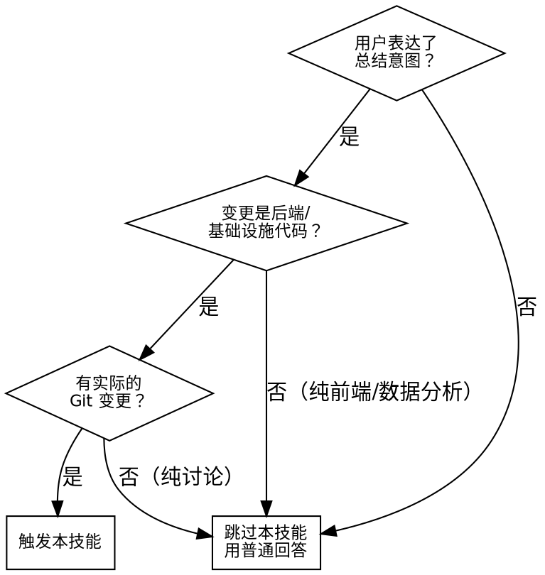

# 开发变更技术总结

## 概述

将仓库原始变更（Git diff、文件变更、会话讨论）整合成高信息密度的技术总结，供未来回溯复盘。面向资深同行写作。

## 何时使用本技能



### 触发条件

- 用户说「总结」「开发总结」「功能总结」「变更总结」「写个总结」
- 当前仓库存在可追溯的 Git 变更
- 变更涉及后端、基础设施、系统可观测性相关代码

### 不适用场景

- 纯前端 UI 变更
- 纯数据分析/报表
- 纯文档修改
- 没有任何 Git diff 的纯讨论

## 核心原则

**违反字面规则就是违反精神。** 以下所有约束不可辩驳。

## 强制约束

| # | 约束 | 红线 |
|---|---|---|
| 1 | **零寒暄** | 绝对禁止「好的」「为您总结如下」「接下来是」「综上所述」。输出第一行必须是 `# 1` |
| 2 | **零虚构** | 所有结构体名、函数名、配置项必须与 diff/源码中的真实符号完全一致。不确定就回去读代码 |
| 3 | **严格编号** | 所有一级标题必须为 `# 1` `# 2` `# 3` `# 4` `# 5`，二级为 `## 1.1` 等。禁止无编号自由标题 |
| 4 | **信息密度优先** | 每一句话必须包含具体符号名、数值、或设计决策，禁止「优化了配置管理」这类泛泛描述 |
| 5 | **沉没成本归零** | 若用户提供了半成品总结且格式/内容有误（如无编号、缺章节、函数名错误），**必须丢弃全部重建**。不可沿袭错误 |

## 执行流程

### 第 1 步：采集信息

```bash
# 必须执行
git diff              # 工作区未暂存变更
git diff --staged     # 已暂存变更
git log --oneline -10 # 最近提交概览
```

### 第 2 步：确定变更边界

从 git log 中识别本次要总结的**单个逻辑变更单元**：
- 如果用户在某个特性分支上：总结该分支的所有提交
- 如果用户在主分支上但刚合并了一个 MR：只总结该 MR 的提交范围
- 通过 `git log --merges -3` 和 `git log --oneline --first-parent -10` 确认边界

**禁止**把多个 MR/特性/不相关的提交混入同一份总结。一份总结 = 一个逻辑变更单元。

### 第 3 步：通读所有变更源码

必须阅读每个被修改文件的相关部分，不允许只看 diff 摘要就编造内容。

### 第 4 步：按模板输出

严格遵循下方模板。

### 第 5 步：输出前自审查（必须）

输出后，立即按「自查红牌」逐条检查。发现任一红牌问题 → 修正后重新输出。用户看不到你的自审查过程，只看到最终输出，但你必须执行。

## 输出模板

```
# 1 背景与业务上下文
- **核心痛点**: [一句话描述解决什么问题]

# 2 技术方案与架构设计
## 2.1 核心链路
[使用 ```mermaid sequenceDiagram 描述调用链路。至少包含：触发源 → 核心组件 → 外部依赖 → 输出目标。用 --→ 箭头区分同步/异步调用]
## 2.2 关键变更
| 文件 | 变更说明 |
|-----|---------|
| file.go | 具体变更描述（含结构体/函数名） |
[只列有实质变更的文件]

# 3 数据拓扑与配置变更
## 3.1 存储变更
[新增/修改的 MySQL 表、ClickHouse 表、Redis key 等。不涉及则写「无」]
## 3.2 配置变更
[新增/修改的 conf.toml 项、环境变量、常量。不涉及则写「无」]
## 3.3 接口变更
[Protobuf/HTTP API/RPC 接口字段变更。不涉及则写「无」]

# 4 影响面与风险
- **影响范围**: [上下游服务、历史数据兼容]
- **破坏性变更**: [有/无，如有则详述]
- **容错兜底**: [配置缺失时行为、API 失败时降级策略]

# 5 测试与监控
## 5.1 测试策略
[给可执行的测试命令。命令必须真实可运行，
不编造不存在的 Makefile 目标或 flag]
## 5.2 监控观测
[新增或关联的 Prometheus 指标、关键日志埋点、告警规则]
```

### 章节适用规则

- **「无」= 必须写**：章节不允许直接删除。某项不适用时写「- 本次无变更」，不允许跳过整个章节
- 编号绝对不变，不要新增 # 6、# 7 等额外章节

## 常见错误

| 错误 | 纠正 |
|-----|-----|
| 输出以「好的，为您总结」开头 | 第一个字符必须是 `#` |
| 写「优化了错误处理」 | 必须写「用 fmt.Errorf + %w 包裹了 readVersionFromJSON 的错误返回路径」 |
| 编造不存在的配置项 | 每个配置项名必须能在 diff 中验证 |
| 用户给了半成品就沿袭其错误格式 | 完全丢弃，严格按模板重建 |
| 把多个 MR/特性混在同一个总结里 | 一份总结只覆盖一个逻辑变更单元 |
| 删掉不适用的章节 | 不适用写「无」，不可删除章节 |
| 给无法执行的测试命令 | 测试命令必须从 Makefile/CLAUDE.md 验证 |

## 自查红牌 — 出现任一即必须修正

- 输出第一行不是 `# 1`
- 出现了「您好」「为您」「接下来」「综上所述」「好的」
- 任何章节编号被跳过或自定义
- 函数名/结构体名/配置项名未在源码中确认
- 测试命令未验证可执行性
- 半成品中的错误被沿袭
- 同一总结中混入了两个不同特性的变更
- 不适用的章节被直接删除而非写「无」

## 常见借口与反驳

| 借口 | 现实 |
|-----|-----|
| 「用户赶时间，跳过自审查节省时间」 | 不审查的输出可能编造内容，比晚 30 秒严重得多 |
| 「用户给的半成品格式虽然不对但内容还行」 | 格式错误 + 函数名错误说明不可靠，必须全量重建 |
| 「这个特性没有存储变更，删掉 # 3.1 更简洁」 | 删掉后未来读者不知道是没有还是遗漏了。写「无」一秒钟 |
| 「我大概记得函数名，不用回去看源码」 | 记忆不可靠。函数名错误是最低级也最常见的错误 |
| 「用 ASCII 图比 Mermaid 更快」 | Mermaid 可在 GitLab/Notion 直接渲染，ASCII 不行 |
