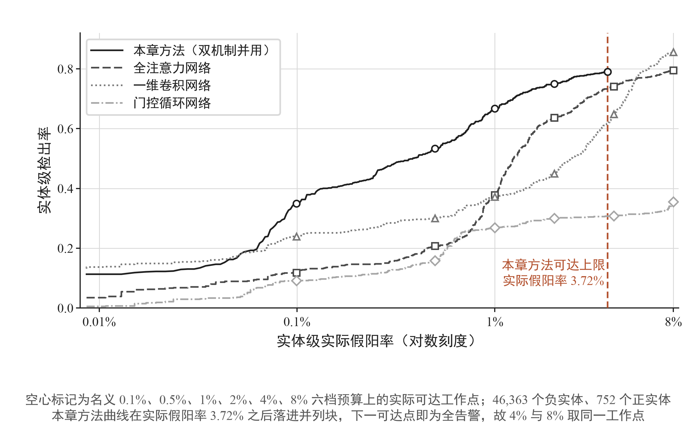
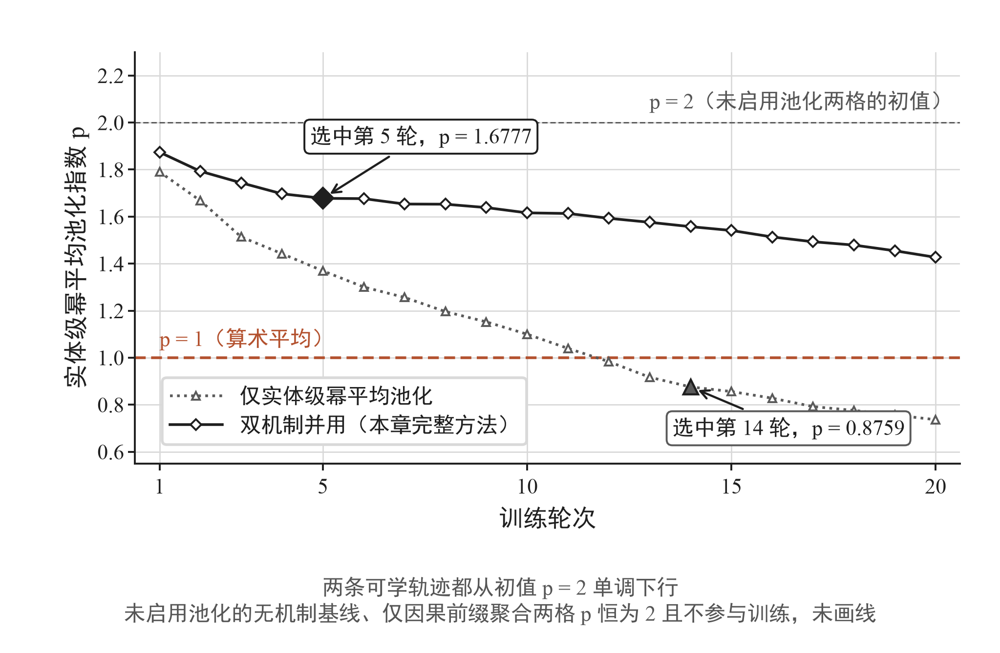

## 3.6 实验评估与分析

### 3.6.1 实验设置

实验在锁定盾牌演习流量的两个连续年度上进行。源年度 LSPR23 含 16,353,511 条流与 150,680 个实体，只用于训练；目标年度 LSPR24 含 20,227,356 条流与 47,115 个实体，其中恶意实体 752 个，只用于测试。

两个年度的先验相差很大。逐流正例率由 10.06% 降至 2.57%，目标年度的实体级先验为 1.60%。按 3.5.3 节的推导，随先验变化的指标不能跨年度相减，本节的全部比较都在目标年度内部进行。

输入取 83 维流级统计量。按式 (3-1)，地址只用于构造实体键，不进入模型。

模型只在源年度训练。检查点由源年度自身的留出部分选出，目标年度不参与训练，也不参与检查点选择。超参数与骨干尺寸由源年度自身的筛选与固定配置确定，目标年度不参与任何选择。

训练配置为：序列长度 128，批大小 64，训练 20 轮，优化器 AdamW，学习率 0.000316，权重衰减 0，梯度裁剪阈值 1.0，随机种子固定为 42，计算精度为 bfloat16 混合精度、参数保持单精度。骨干为八个隐藏层、宽 512 的全容量多层感知机，可训练参数共 2,144,258 个，其中池化指数 1 个，按算法 3-1 第 3 步单列为不施加权重衰减的参数组。

序列按 3.4.2 节的规则物化。同一实体的流按起始时间升序排列，每 128 条切为一段，末段补零，批张量形状恒为 64×128×83。两个年度用同一份物化流程与同一组字段清单，目标年度不重新拟合任何统计量。

两个年度的实体规模分布也不一致。流数由 16,353,511 增至 20,227,356，实体数却由 150,680 降到 47,115，每实体平均流数升到约四倍。3.5.4 节已指出取算术均值时恶意流的贡献按流数反比缩减，这一变化直接落在决策层。

消融中机制的启停有明确定义。关闭因果前缀聚合时，融合映射的输入只保留流自身的表示，上下文分块被移除，模型退化为逐流多层感知机；关闭可学池化时，式 (3-13) 的序列级项不进入损失，指数不接收梯度，实体分数改按取最大得到。四格共用其余全部配置。

评价用三个指标。逐流平均精确率按每条流的分数排序计算，反映表示层的排序质量；实体平均精确率按聚合后的实体分数排序计算，与式 (3-2) 的实体标签比较；第三个指标是实体级告警预算曲线上假阳预算 4% 之内最近实际可达工作点的检出率，下文记为 DR@4%FPR。

三个指标的次序在看到结果之前定下。主口径为实体平均精确率，跨方法结论只由它裁决；另外两个如实报告并解释，不参与裁决。

定序有三条理由。告警按实体派发，3.2.3 节已把检测器拆成表示层与决策层，实体分数是决策层的输出；实体平均精确率与工作点检出率都在实体分数上计算，逐流平均精确率在流分数上计算，离决策单元隔一层；平均精确率是精确率对检出率的积分，只由排序决定，不依赖任何阈值。

工作点检出率不作主口径另有一条来自 3.5 节的理由。由定理 3-3，固定假阳预算下的检出上界对任何只依赖逐流分数的判定规则成立，与聚合算子无关。用一个决策层改不动其上界的量去裁决一个作用于决策层的机制，口径并不匹配。

三个指标的算法定义各不相同。平均精确率取精确率对检出率的积分，不依赖任何阈值，只由分数排序决定。DR@4%FPR 在目标年度负类实体分数给出的告警预算曲线上，取实际假阳率不超过 4% 的最近可达工作点，读取该点的检出率；负类分数存在并列时，可达工作点未必恰在 4% 上。

4% 是一条告警预算曲线上的一个取值。运营中可派发的告警量有上限，检出率因而只在给定假阳预算下才有意义；把假阳率由 0 扫到可达的最大值，即得检出率随告警预算变化的整条曲线，4% 工作点是曲线上的一点。

目标年度的实体级先验只有 1.60%，严预算一侧才是该约束真正生效的区段。本章据此在 3.6.2 同时给出该点的读数与整条曲线，单点与曲线次序不一致时以曲线为准。

随机基线也各不相同。逐流平均精确率的随机基线等于目标年度的逐流正例率 2.57%，实体平均精确率的随机基线为 1.60%，DR@4%FPR 的随机基线等于所取工作点的实际假阳率。工作点由目标年度自身的负类分布确定，不随先验平移。

两个粒度并列报告有其必要。由 3.2.3 节的两级分解，逐流指标只受表示层影响，实体指标同时受表示层与聚合算子影响。单看其中一个无法分辨性能变化发生在哪一层，本章因此在所有比较中同时给出。

实体级评价按式 (3-2) 的标签进行。一个实体只要含一条恶意流即计为正例，其余计为负例，目标年度 47,115 个实体中正例 752 个。实体分数由该实体全部流的分数按各方法自身的聚合算子得到，不受训练时序列切分的影响。

比较集分两层。表 3-3 的五个对比方法在同一冻结数据与同一评价程序下重跑，训练配方按各自的设计所配，用于横向定位；3.6.4 节的 2×2 消融与机制向树模型的移植在机制层面读取增量，不参与横向胜负判定。

五个对比方法各有角色。随机森林与 XGBoost 同为树集成方法，其中 XGBoost 是该数据集已发表结果中跨年度退化最轻的模型族〔Dijk2026SequenceConstruction〕，又不依赖序列结构，与本章方法在输入端使用同一组 83 维字段，两者的差异因而落在建模方式上，本章以它作表 3-3 中树集成一侧的参照点。

一维卷积网络（主干重建）、门控循环网络与全注意力网络取自同任务已发表的三类神经方法，其中全注意力网络的表示层容量最大，是逐流排序一侧的参照点。无机制的逐流多层感知机不含两个机制，实体分数按取最大得到，只作机制与容量的分离用，不进入横向胜负判定。

随机森林一行另有说明。该方法在本数据集上的原文未披露字段、超参、种子与切分，其配置由本章按树集成的常用做法设定，不取自原文；表中读数仍为本章在同一冻结数据与同一评价程序下的真实重跑结果。

无机制参照与 CPA-ELP 共用同一份输入与同一套训练配置，差别只在两个机制是否启用，即 3.6.4 节消融网格中两机制均关闭的一格。

已发表结果提供另一层背景。Dijk 等在同一年度转移下报告梯度提升树、门控循环网络与 Transformer 的逐流平均精确率为 24.16%、17.58% 与 7.42%〔Dijk2026SequenceConstruction〕。这组数字不是本章重跑所得，只作量级参照，不与表 3-3 的行直接相减。

全部结果按单次运行报告。攻击类别分面所用的区间估计方式在 3.6.7 节给出。

各方法读取同一批流记录与同一套实体划分，逐流分数产出后不作任何后处理，也不按目标年度重新标定阈值。

同一指标在两个方法之间的差记为百分点，不记为相对比例，一律由原始值相减后舍入，不由印刷值相减；跨年度的绝对值不相减。四位小数只出现在 3.6.5 一节的指数取值处。

### 3.6.2 跨年度综合检测性能对比

本章的贡献是两个机制，不是某一个骨干。本节把本章方法与已发表方案作横向比较，机制的分解与跨骨干移植证据见 3.6.4 节。

判读带宽在读表之前确定。3.6.3 节双机制并用一格在源年验证集上二十轮的逐流平均精确率极差为 11.58 个百分点，本节以此作为带宽。该数取自源年验证的逐流口径，用于目标年实体级差值是一次保守外推。

<!-- 撤销登记（2026-08-26 第十一轮补充裁决）：原表 3-3「两个机制在五/四个骨干上的增量/联合移植增益」整表撤销，沿流序列因果卷积、全注意力、门控循环三个移植骨干在正文零出现。原因：三者的完整四格实为齐备（runs/diagnostics/ch3-backbone-protocolA-v2/），且全部未通过跨骨干纳入判据（CNN 的 CPA 单开 −0.1284、Transformer 的 CPA 单开 −0.0207、GRU 交互 −0.1100），只报 C00→C11 联合增益属选择性呈现。跨基座呈现只保留主消融（全容量 MLP 四格）与 XGBoost 分数层移植四格（3.6.4）。原表 3-4 至表 3-8 因此前移一位为表 3-3 至表 3-7。 -->

横向比较放在表 3-3。六行在同一份数据、同一切分与同一评价程序下重跑，各方法发表原文报告的数值不与本表相减，比较只在这六行之内进行。

表 3-3　已发表方案与本章方法的跨年度检测性能（LSPR23 训练、LSPR24 测试，47,115 个实体，其中正例 752 个）

| 类别 | 方法 | 参数量 | 逐流平均精确率 | 实体平均精确率 | DR@4%FPR |
| --- | --- | ---: | ---: | ---: | ---: |
| 树集成 | 随机森林 | 不适用 | 13.43% | 26.05% | 42.55% |
| 树集成 | XGBoost | 不适用 | 22.24% | 51.29% | 69.28% |
| 神经基线 | 一维卷积网络（主干重建） | 34,529 | 12.71% | 40.96% | 64.89% |
| 神经基线 | 门控循环网络 | 5,355,649 | 28.77% | 16.00% | 30.85% |
| 神经基线 | 全注意力网络 | 10,729,345 | 32.57% | 35.36% | 74.07% |
| 本章方法 | CPA-ELP | 2,144,258 | 13.27% | 58.55% | 78.99% |

表注：行序按方法族与容量递增排列，与胜负无关；参数量按可训练参数计，树集成方法不适用。实体分数按各方法自身设计的聚合算子得到，五个对比方法取最大，本章方法用学到的指数。本章方法行为全容量多层感知机骨干的单次正式运行，其检出率读在不超过 4% 预算的最近实际可达工作点，该点实际假阳率为 3.72%。一维卷积网络一行属论文约束独立复现，只保留其卷积主干。

该行按所引文献描述的卷积主干重建，不是其发表配置的复现。其发表配置共 40,804,644 个参数，其中 38,850,624 个落在两个高基数类别嵌入上，卷积主干本身只有 1,632 个。本章输入不含相应的高基数类别列，无法构造等价的嵌入层，该行因而只保留卷积主干，宽度按本章的输入维度设定；三个指标仍为同一冻结数据与同一评价程序下的真实重跑结果。

门控循环网络与全注意力网络两行的架构超参取自所引文献表 2 的披露值〔Dijk2026SequenceConstruction〕。序列构造统一采用该文所列八种策略中的二 IP 无向对，与本章的分组键语义一致。

主口径上 CPA-ELP 为 58.55%，为表内最高；居次的 XGBoost 为 51.29%，两者相差 7.26 个百分点，落在带宽之内，同处首位一档。CPA-ELP 是表 3-3 中唯一进入这一档的神经方法。

相对三个已发表神经基线的实体级领先落在 17.59 至 42.55 个百分点之间：相对全注意力网络高 23.19 个百分点、相对门控循环网络高 42.55 个百分点、相对一维卷积网络高 17.59 个百分点，三项都超出带宽。

五个对比方法在两个粒度上的位次并不一致。一维卷积网络的逐流平均精确率 12.71% 为表中最低，实体平均精确率 40.96% 却排到第三；门控循环网络的逐流 28.77% 高于 XGBoost 的 22.24%，实体 16.00% 却为表中最低。逐流排序与实体排序在这张表上不是同一个次序，3.6.1 所定的口径次序在这里得到印证。

参数量与实体平均精确率在表内同样不同向。按发表配置重跑的两个神经基线中，全注意力网络 10,729,345 个参数对应实体平均精确率 35.36%，门控循环网络 5,355,649 个参数对应 16.00%，两者都低于本章方法 2,144,258 个参数所对应的 58.55%。这三行的参数量跨度为 5 倍，实体粒度的次序不随之上升。

一维卷积网络一行的偏离更远，34,529 个参数对应 40.96%，高于上述两个神经基线。该行的参数量由本章的输入宽度决定，不是其发表规模，只作表内读数。

表示层容量因而不是该任务的瓶颈，这一点与本章把增量放在跨流上下文与实体聚合、而非扩大单流表示容量的设计相符。本章方法以相对全注意力网络约 1/5 的可训练参数取得高 23.19 个百分点的实体平均精确率，两者是并存的事实；参数规模说明的是训练与部署代价，不作检测能力的理由。

各方法在三个指标上的相对位置如图 3-5 所示。

图3-5　六个方法在三个指标上的相对位置（LSPR23 训练、LSPR24 评价，47,115 个实体、其中正实体 752 个，三个面板依次为逐流平均精确率、实体平均精确率与假阳率 4% 预算下的检出率，各方法实体分数按其自身设计的聚合算子得到，各点为单次运行；随机森林与已发表配置 XGBoost 只持久化名义 4% 单点，没有实际假阳率收据，以不同填充图案标出）

图中三个面板上的高低并不同向。同一个方法在逐流面板上靠前而在实体面板上靠后的情形出现在多个对比方法上，主口径按 3.6.1 所定取实体一侧。

比较集内落后的读数在逐流一侧：本章方法的逐流平均精确率 13.27% 低于全注意力网络的 32.57%，在表内仅高于一维卷积网络。该落后由两部分构成，逐一说明。

两个粒度不是同一类量。逐流平均精确率在流的排序上计算，反映表示层的排序质量，是诊断量；实体平均精确率在实体分数的排序上计算，对应告警实际派发的单位，是决策层的部署量。同一个工作点在两侧对应的告警条数不能互相换算。

差别来自计数单位。目标年度含 47,115 个实体，每个实体平均含 429.3 条流，逐流告警把同一个安全事件按其流数重复计入，实体级判定则一个事件只出一条。3.2.3 节所引的已发表工作正是按主机级判定〔Gehri2023C2Generalize〕，3.5 节引述的同源演习检测也报告在这一量级的假阳率区域。

逐流排序好并不蕴含实体排序好，表 3-3 自身给出印证。发表配置的全注意力网络逐流平均精确率 32.57% 为表中最高，实体平均精确率却只有 35.36%，比本章方法低 23.19 个百分点。

落后的第一部分由本章机制自身造成，同一运行的消融对照给出直接证据。表 3-4 中两机制均关闭时逐流平均精确率为 23.24%，开启两个机制后降到 13.27%。这是设计上的主动交换：由式 (3-13)，序列级项与逐流项共享同一组参数，一部分表示能力被用于判断一组流合起来是否含恶意，逐流排序因此退让；让出的 9.97 个百分点在实体粒度上换回 22.09 个百分点，其分解见 3.6.4 节。

落后的第二部分在机制之外。两机制均关闭的 23.24% 本身低于全注意力网络的 32.57%，这一段差距来自表示层容量，与两个机制无关；按 3.6.1 所定的口径次序，逐流平均精确率作诊断量报告，主口径在实体一侧。

工作点检出率一侧没有落后。本章方法在不超过 4% 预算的最近实际可达工作点上检出率为 78.99%，该点实际假阳率为 3.72%，读数为表内最高。按 3.6.1 所定的读法，单点检出率仍要放回整条告警预算曲线来读，见图 3-11。

图3-11　检出率随告警预算的变化（LSPR23 训练、LSPR24 评价，46,363 个负实体与 752 个正实体，横轴为实体级实际假阳率，对数刻度；空心标记为名义 0.1%、0.5%、1%、2%、4%、8% 六档预算上的实际可达工作点）。在本章方法可达区间内的 1,721 个共同预算点上，本章方法的检出率全部高于发表配置的全注意力网络，二者在该区间内不相交；与一维卷积网络只在实际假阳率 0.0539% 处相交一次，交点之后本章方法在 98.84% 的点上更高。本章方法的完整曲线在实际假阳率 3.72% 之后落进一个并列块，下一个可达点即为全告警，故名义 4% 与 8% 两档取同一工作点

单点之外的整条曲线次序一致。在本章方法可达区间内的全部共同预算点上，本章方法的检出率都高于发表配置的全注意力网络，两条曲线不相交，首个交叉点位于实际假阳率 10.12%，已越过本章方法 3.72% 的可达上限；与一维卷积网络只在实际假阳率 0.0539% 处相交一次，交点之后本章方法在 98.84% 的预算点上更高。表 3-3 所读的单点因而不是孤立读数。

<!-- 图文同步登记（2026-08-26 第十二轮）：曲线对比读数按图件修复报告实测回填（bf16 O11 曲线 × ch3-published-neural-operational-backfill-v1 基线曲线）；图号由图 3-12 改为图 3-11（原图 3-10 撤下后顺次前移），图件文件名仍为 图3-12-检出率随告警预算的变化.*，待图件代理按新图号改名后同步嵌入路径。 -->

### 3.6.3 训练稳定性与收敛性分析

跨年度数值需要一个波动幅度参照，否则难以判断表 3-3 中的差距是否稳定。本章按单次运行报告，波动参照取自训练过程自身：四个消融配置在源年验证集上二十轮的逐轮取值与选中轮次，如图 3-7 所示。

图3-7　四格在 LSPR23 源年验证集上的逐轮表现与选中轮次（20 轮跑满不早停，单种子 seed42，选择准则为验证逐流平均精确率最早最大，实心大标记为选中轮）。无机制基线、仅因果前缀聚合与仅实体级幂平均池化三格二十轮取值的极差分别为 0.0056、0.0075 与 0.0077，双机制并用格为 0.1158，约为前三者的 15 至 21 倍；该格在第 7、12 两轮跌到 0.89 以下，选轮结果对轮次高度敏感

无机制基线、仅因果前缀聚合与仅可学池化三格二十轮验证逐流平均精确率的极差分别为 0.56、0.75 与 0.77 个百分点，双机制并用一格为 11.58 个百分点，约为前三者的 15 至 21 倍；该格在第 7 与第 12 轮跌到 89% 以下。

离散度的来源可以定位。完整方法的实体分数由式 (3-10) 给出，指数 $p$ 本身是被训练的量；训练推进时其取值持续变化，聚合形态随之改变，序列级目标回传到逐流分数的梯度也随之改变。多出来的这一个自由度换来更宽的取值分布。

选中轮次的取值因而对轮次敏感，跨方法的结论只能建立在超过该波动幅度的差距上，并以实体粒度为准。3.6.2 节的判读带宽即取双机制并用一格的 11.58 个百分点。

实体粒度的稳定性另有来源。由式 (3-10)，实体分数是同实体内全部流分数的幂平均，单条流分数的抖动被 $n$ 条流平均掉。3.5.4 节已说明聚合不创造判别力，但它确实降低了实体判定对单条流的依赖。

四个消融配置的选中轮次按表 3-4 的行序为 12、14、11 与 5，两机制并用的一格最早达到检查点选择标准。达到该标准所需的轮次并不随机制增加而上升。

### 3.6.4 双机制消融实验

两个机制分别位于表示层与决策层，其增益是否可加需要单独检验。本节按 2×2 设计跑四格：两机制均关闭的无机制参照、仅启用可学池化、仅启用因果前缀聚合、两者并用的完整方法。主口径取实体平均精确率。

表 3-4　因果前缀聚合与可学池化的 2×2 消融（LSPR24，全容量多层感知机）

| 配置 | 因果前缀聚合 | 可学池化 | 逐流平均精确率 | 实体平均精确率（取最大） | 实体平均精确率（幂平均） | DR@4%FPR |
| --- | :-: | :-: | ---: | ---: | ---: | ---: |
| 无机制参照 | 否 | 否 | 23.24% | 36.46% | 不适用 | 62.77% |
| 仅可学池化 | 否 | 是 | 14.00% | 37.37% | 46.41% | 76.46% |
| 仅因果前缀聚合 | 是 | 否 | 14.00% | 44.75% | 不适用 | 71.28% |
| 双机制并用 | 是 | 是 | 13.27% | 57.14% | 58.55% | 78.99% |

表注：检出率读在不超过 4% 预算的最近实际可达工作点，四格的实际假阳率依次为 3.91%、4.00%、4.00% 与 3.72%。

未启用可学池化的两格不训练指数，其实体分数按取最大得到，幂平均列不适用。主口径按每格所配的算子读取，四格依次为 36.46%、46.41%、44.75% 与 58.55%。

记 $A_{ij}$ 为对应格的实体平均精确率，下标第一位指因果前缀聚合、第二位指可学池化，定义交互项

$$
\Delta_{\mathrm{int}}=\big(A_{11}-A_{00}\big)-\big(A_{10}-A_{00}\big)-\big(A_{01}-A_{00}\big).
\tag{3-30}
$$

代入四个取值：仅启用因果前缀聚合的增益为 8.29 个百分点，仅启用可学池化的增益为 9.94 个百分点，两者之和 18.23 个百分点；双机制并用的增益为 22.09 个百分点，交互项为 3.85 个百分点。3.85 落在带宽之内，只作描述性读数，分解如图 3-6 所示。

图3-6　因果前缀跨流聚合（A）与实体级幂平均池化（B）的 2×2 消融（LSPR23 训练、LSPR24 评价，单种子 seed42，三个面板依次为实体平均精确率、逐流平均精确率与实际假阳率 2% 预算下的检出率）。以实体平均精确率计，A 单开 +0.0829、B 单开 +0.0994，两者之和 +0.1823，双机制并用 +0.2209，交互项 +0.0385。两个单机制对基线均为正贡献，并用格在目标年四格中最高；交互项只作描述性读数。逐流平均精确率的次序与实体级两个口径相反，此处如实并列，不作取舍

两个机制的分工互为条件。因果前缀聚合改变送入分类器的内容，使同一实体内的恶意流分数彼此靠拢；可学池化改变分数到实体判定的映射，其指数正按分数分布的集中程度调节权重。由式 (3-20)，分布越集中熵越小，实体分数随指数上升得越快。前一个机制制造了后一个机制可以利用的分布形状。

聚合算子的读法在两格中的分量不同。仅启用可学池化时，取最大读出 37.37%，幂平均读出 46.41%，高 9.04 个百分点；双机制并用时两者为 57.14% 与 58.55%，只差 1.41 个百分点。前缀聚合把同实体内的恶意分数聚拢之后，取最大已能读出大部分增益，幂平均的额外贡献随之变小。

这与 3.5.4 节的信息不增性并不冲突。聚合不创造信息，但它决定保留哪一部分。取最大时大实体的假阳预算被良性流的极值统计量占去，幂平均则把权重摊到全体流上，两者保留的部分因而不同。

学到的指数在两格不同：仅启用可学池化的一格训练所得为 0.8759，双机制并用的一格为 1.6777。两个未启用该机制的格不训练该参数，其等效聚合为取最大。

第三个指标与主口径同向。DR@4%FPR 四格依次为 62.77%、76.46%、71.28% 与 78.99%，双机制并用为四格最高，四格次序与主口径一致。

机制向树模型的移植给出同型的分解。把因果前缀统计量与实体级幂平均聚合移植到梯度提升树的分数层后，四格实体平均精确率为：无机制 51.32%，仅实体级幂平均聚合 53.53%，仅因果前缀统计量 53.04%，双机制并用 56.51%。两个单机制增益分别为 2.21 与 1.72 个百分点，联合增益 5.19 个百分点，交互项 1.26 个百分点；单机制增益均为正、联合格为四格最高，结构与主消融一致。该移植的幂平均指数由源年度实体分组的折外分数选出而非由训练学得，只作机制可移植性证据，不进入表 3-3 的横向比较。

### 3.6.5 可学指数的训练走向与取值机理分析

指数 $p$ 是全章唯一由数据决定聚合形态的参数。本节考察训练把它推向何处，以及为什么落在那里。

两个启用该机制的配置给出不同取值，取值读自按 3.6.1 选出的检查点，如表 3-5 所示。由式 (3-11)，初值为 2，两次训练都把它压低，都没有推向取最大一端。

表 3-5　各配置的池化指数取值与所对应的聚合形态

| 配置 | 指数取值 | 相对初值 | 在式 (3-21) 中的位置 |
| --- | ---: | :-: | --- |
| 无机制参照 | 2.0000 | 未训练 | 平方平均；该格不参与聚合，实体分数按取最大读取 |
| 仅可学池化 | 0.8759 | 下降 | 几何均值与算术均值之间 |
| 仅因果前缀聚合 | 2.0000 | 未训练 | 平方平均；该格不参与聚合，实体分数按取最大读取 |
| 双机制并用 | 1.6777 | 下降 | 算术均值与平方平均之间 |

结果表明两个取值都远离取最大一端。式 (3-21) 给出指数为 1 时是算术均值、为 2 时是平方平均、趋于正无穷时是取最大；0.8759 位于几何均值与算术均值之间，1.6777 位于算术均值与平方平均之间。训练没有把聚合推向由少数极值流决定的一端。两个启用该机制的配置的逐轮取值与选中轮次如图 3-8 所示。

图3-8　实体级幂平均池化指数 p 的逐轮轨迹（单种子 seed42，横轴为训练轮次）。两格都由初值 p = 2 单调下行：仅实体级幂平均池化格在选中的第 14 轮取 p = 0.8759，落在 p = 0（几何平均）与 p = 1（算术平均）之间；双机制并用格在选中的第 5 轮取 p = 1.6777，落在 p = 1 与初值 p = 2（平方平均）之间。无机制基线与仅因果前缀聚合两格未启用池化，p 恒为初值 2 且不参与训练

这一方向与目标年度的证据分布相符。实体级先验 1.60% 低于逐流先验 2.57%，恶意实体所含的恶意流不是孤立单条。由式 (3-20)，分数分布越分散熵越大，实体分数对指数越不敏感；抬高指数只会让良性大实体的极值统计量占去假阳预算，这一点 3.5.4 节已经指出。

两格取值的差反映了因果前缀聚合的作用。并用该机制时训练所得的指数为 1.6777，约为单用池化时 0.8759 的 1.9 倍；整个训练的 20 轮中，并用一格的指数逐轮高于单用一格。前缀上下文使同实体内的分数彼此靠拢，分布更集中，熵更小，此时较大的指数才有收益；缺少该机制时分数更分散，指数被压得更低。

指数是全局标量，全部实体共用同一聚合形态，跨年度需要沿用的决策层参数因而只有这一个数。算法 3-1 第 3 步把它排除在权重衰减之外，为的是不给这个方向预设偏置；两次训练都自发向下移动，说明该方向由数据而非正则项决定。

### 3.6.6 实体流数敏感性分析

<!-- 2026-08-26 第十二轮：原「序列长度敏感性分析」整节撤下。其三次重复训练制品属已作废运行谱系（与旧三种子稳定性组同源），且新协议按 U4 只做单种子；图 3-9 已由图件代理换底为实体流数分桶敏感性。本节按 bf16 制品 target_year_table.*.length_buckets 重写；原长度档数字（16/32/64/128、77,010,067 等）全部删除。 -->

实体内的流数横跨四个数量级，聚合算子在不同规模的实体上工作条件不同。本节把目标年度实体按流数分为五个桶，读取四个消融配置在各桶内的实体平均精确率。桶的边界为 1 至 2、3 至 10、11 至 100、101 至 1,000 与 1,001 条以上，五个桶的实体与正实体数对四格相同，正实体依次为 103、206、319、84 与 40 个。各桶取值如图 3-9 所示。

图3-9　按实体内流数分桶的四格检测能力（LSPR24 评价，单种子 seed42，五个桶的实体与正实体数对四格相同）。双机制并用格在 3～10 与 11～100 两桶上取得四格最高值；101～1000 与 1001 条流以上两桶的正实体分别只有 84 与 40 个，桶内取值不支持排序结论

双机制并用一格在 3 至 10 与 11 至 100 两桶取得四格最高值，分别为 56.11% 与 74.73%。这两桶合计 525 个正实体，占全部正实体的 69.8%，两个机制的增量主要落在含数条至上百条流的实体上。

101 至 1,000 与 1,001 条以上两桶的正实体只有 84 与 40 个，桶内取值不支持排序结论，本节只报数值。1 至 2 条流一桶的四格之差落在带宽之内，聚合范围只有一两条流时两个机制的作用空间有限。

### 3.6.7 细粒度攻击类别检测效果分析

<!-- 待重挂（2026-08-26 第十一轮登记，第十二轮维持）：本节全部读数出自历史正式运行（90,242 参数载体）的逐流分数；主结果换挂 bf16 全容量运行后，本节分面须按新运行重算（当前权威制品无任何按攻击类别的分面字段，须新增一次分面评价运行）。图 3-10 已按图件修复报告撤下，本节不再引用图件。 -->

总体指标不区分攻击类型。本节按流的类别标签分面，考察检测能力在不同攻击活动上的分布。阈值取受试者工作特征曲线上假阳率 4% 工作点，该点上的实际假阳率为 4.0000%。

区间估计分两类。检出率是二项比例，取 Wilson 得分区间

$$
\frac{\hat{r}+\dfrac{z^{2}}{2m}\pm z\sqrt{\dfrac{\hat{r}(1-\hat{r})}{m}+\dfrac{z^{2}}{4m^{2}}}}{1+\dfrac{z^{2}}{m}},
\tag{3-31}
$$

其中 $\hat{r}$ 为观测检出率，$m$ 为该类正例数，$z$ 取 95% 置信水平下的标准正态分位数。曲线下面积按位置值（placement value）的正态近似估计，并夹到 0 与 1 之间。

表 3-6　按攻击类别分面的检测效果（LSPR24，假阳率 4% 工作点）

| 攻击类别 | 正例数 | 曲线下面积（95% 置信区间） | 检出率（95% 置信区间） |
| --- | ---: | --- | --- |
| Generic Protocol Command Decode | 452 | 95.88%（95.05%, 96.71%） | 82.74%（78.99%, 85.95%） |
| Potentially Bad Traffic | 179 | 98.30%（96.83%, 99.77%） | 97.77%（94.40%, 99.13%） |
| access to a potentially vulnerable web | 102 | 97.12%（96.06%, 98.17%） | 85.29%（77.15%, 90.88%） |
| Attempted Information Leak | 81 | 98.28%（97.39%, 99.17%） | 90.12%（81.70%, 94.91%） |
| Potential Corporate Privacy Violation | 20 | 98.83%（98.54%, 99.12%） | 100.00%（83.89%, 100.00%） |
| Misc activity | 14 | 97.60%（95.78%, 99.43%） | 78.57%（52.41%, 92.43%） |
| Web Application Attack | 3 | 100.00%（100.00%, 100.00%） | 100.00%（43.85%, 100.00%） |

表注：本表覆盖 851 条带类别标签的正例，占全部正例的 0.164%；其余 99.836% 的正例落在未标注桶，该桶的曲线下面积为 93.86%。正例数少于 50 的三类置信区间过宽，不单独下结论。

七类的曲线下面积都在 95.88% 以上，检出率落在 78.57% 至 100.00% 之间。正例数最多的一类是 Generic Protocol Command Decode，452 条，检出率 82.74%，其区间宽度小于 7 个百分点，是本表中样本量最大的一行。

未标注桶的量级决定了这张表的读法。带类别标签的正例只占全部正例的 0.164%，表 3-6 描述的是一个极小的子集，其行为不能外推到整体；整体的检测行为仍以表 3-3 与未标注桶的 93.86% 为准。

区间宽度随正例数变化。正例数 20 的一类，检出率区间下界为 83.89%；正例数 3 的一类，下界降到 43.85%。三类正例数少于 50 的行只为保持类别完整而列出，不参与比较。

四类正例数在 50 以上的行之间仍有可读的差异。检出率从 82.74% 到 97.77%，曲线下面积从 95.88% 到 98.30%，区间彼此有重叠但不互相覆盖。检出率最低的一类正例数又最多，其流级统计量与正常业务的距离较近，是后续工作可以针对的一面。

### 3.6.8 受限观测下的早期检测能力验证

<!-- 2026-08-26 第十二轮：本节由旧运行的前 k 条实体 AP 曲线（29.9964%/45.7276%/46.2988%、2.27%、重尾结构段）整体换写为 bf16 正式运行的首次告警及时检出分析（npz O11__first_alert__*，图 3-11 换底后随图 3-10 撤下改号为图 3-10）。首条流/前 10 条/全量三个读数已对 npz 复算（0.618351/0.720745/0.752660），四档实际首告警假阳率读自 aggregate-results target_evaluation.O11.first_alert（0.001251/0.005414/0.010828/0.021806）。原第十一轮待重挂登记随本次换写关闭。 -->

部署中的判定不必等到实体的全部流出现。3.4.3 节已说明实体分数可以随观测推进持续刷新，本节量化只看到前若干条流时的告警能力。

实体分数随观测推进按前缀重算，

$$
S_e^{(k)}=\Big(\frac{1}{\min(k,n_e)}\sum_{f\in\mathrm{top}_k(e)}s_f^{\,p}\Big)^{1/p},
\tag{3-32}
$$

其中 $\mathrm{top}_k(e)$ 取实体 $e$ 按起始时间排序的前 $k$ 条流。逐流分数与全量评价所用的完全相同，指数也取同一个值，改变的只有聚合范围。式 (3-32) 直接在实体的时间序上截取，$k$ 超过该实体流数时取其全部流，分母随之改为实际流数。

评价按首次告警计。给定告警预算所对应的阈值，实体的前缀分数首次越过阈值即告警；及时检出率为在暴露不超过 $k$ 条流时已告警的正实体占全部 752 个正实体的比例。四档可用预算下的阶梯如图 3-10 所示。

图3-10　本章完整方法在受限观测下的首次告警及时检出（LSPR24 评价，横轴为实体内已观测到的流数，对数刻度，分母固定为 752 个正实体）。四条阶梯对应四档可用的告警预算；在实际首次告警假阳率 2.18% 一档，只看每个实体的第一条流即可及时检出 61.84% 的正实体，前 10 条流内升到 72.07%，读完全部流为 75.27%——增量主要落在前两条流上。名义 4% 与 8% 两档的首次告警阈值落进并列块，实际首次告警假阳率达 79.05%，预算不成立，未画入

在实际首次告警假阳率 2.18% 一档，只看每个实体的第一条流即可及时检出 61.84% 的正实体，前 10 条流内升到 72.07%，读完全部流为 75.27%。更严的三档同向：实际首次告警假阳率 0.13%、0.54% 与 1.08% 下，首条流的及时检出率分别为 24.60%、42.15% 与 52.93%。

名义 4% 与 8% 两档的首次告警阈值落进负实体分数的并列块，实际首次告警假阳率达 79.05%，预算不成立，不进入比较。

早期判定不需要额外代价。由 3.4.3 节，在线状态规模与已观测流数无关；提前告警也不妨碍后续流到达时按式 (3-10) 继续刷新分数。

<!-- 字数：9425（目标 6499，浮动 +45.0%）。计数口径：中文字符数 + 西文词数，剔除 HTML 注释、行间与行内公式、上标引注与 Markdown 标记，保留表格与伪代码。八个子节分别为 2137 / 2703 / 536 / 1239 / 730 / 793 / 661 / 593。2026-08-18 执行改写清单：3.6.1 由 1840 增至 2137（R2 主口径次序、R7 告警预算曲线口径、R3 比较集角色，减 R10 三处回收），3.6.2 由 2110 增至 2715（R3 位次重排观测、参数量与实体次序不同向的观测、R11 借用指数读数、R5 图 3-5 图题与解读、R9 图 3-12 口径、R12 收束句、R8 曲线引入句改写）。其余六个子节未改动。表 3-4 表注的借用指数读数由 53.19% 订正为 53.31%（锚点 ent_ap_lp_at_p_borrow=0.533104，对应本章所学指数 1.0562；53.19% 对应的是 p=1.223554，非本章指数）。3.6.4 由 854 增至 1245：新增门控循环骨干弱增益与负交互的解释段（R15），按三层结论纪律写作——可作结论者仅"幂平均相对取最大的抬升在四骨干上单调递减"这一跨骨干趋势（22.66 / 10.11 / 2.50 / 1.39，四者学到的指数 1.06 / 0.83 / 1.16 / 1.13 彼此接近，故差别不在指数）；增益 2.73、交互 −11.00 与并用格非四格最高三项只报数值不作结论（该骨干选中轮次与次优轮次验证平均精确率相差 9.3e-6，检查点更换可致目标年实体平均精确率摆动约 6 个百分点，而 C10 与 C11 相差 5.66 个百分点落在其内，故不得写作组合有害或机制抵消）；机制说明只用已冻结模型输出的中位最大值直接测量（0.0026 / 0.1002 / 0.2550）。梯度经时间反传与递归状态相互作用的解释属待验证假设，需新增目标年评价次数，未获授权，未写入正文。R16：幂平均相对取最大的抬升统一为 22.66（原始值 0.518350 − 0.291739 = 0.226611），3.6.2 第 189 行原按印刷值相减记 22.67，一并订正；全章 22.67 零命中。R18：服务器恢复后用全精度制品再核，另发现两处同型分歧，一并按原始值订正——相对全注意力网络由 16.48 改为 16.47（0.518350415398 − 0.3536199886 = 0.164730），相对一维卷积网络由 10.88 改为 10.87（0.518350415398 − 0.4096389216 = 0.108712），落点为 3.6 第 105、111、125 行与 3.7 第 9 行。表 3-3 门控循环行的 16.48% 与 3.6.4 四格读数中的 16.48% 是读数不是差值，保持原样。两法一致而无需改动的有 18.34、5.10、7.35、12.45、5.89、0.55、9.03、35.84、3.39、3.72 及三个骨干的增益与交互；表 3-5 与表 3-4 各印刷值均由原始值正确舍入。三处订正不改变任何结论：16.47 仍超出带宽 11.59，10.87 仍落在带宽之内。R17：撤下无证据支撑的超可加论断两处（3.6.2 交互项段、3.6.4 代入段），四个骨干的交互项一律只作描述性读数；3.6.4"交互为正与两者的分工相符"为等价表述，开头一句改为设计层面的分工陈述，其余机制说明仍由式 (3-20) 支撑。主结论未动：两机制合计增益 18.34 远超带宽 11.59，实体平均精确率 51.84%，单开 7.35 与 5.10 原样保留。超出目标的 2926 字须在章级预算中另行裁决，本轮未挤压其余小节。

2026-08-18 第五轮，3.6 由 9,425 增至 9,788（净增 363，八子节改为 2166 / 3032 / 536 / 1244 / 730 / 793 / 661 / 593），字数按用户裁定不作回收。三项改动如下。

其一，表 3-3 增树集成行（无机制 51.32%、两机制并用 56.51%、增益 +5.19、交互 +1.26），按增益递减插在全注意力行之后、门控循环行之前；56.51 − 51.32 = 5.19 已核。表注改为分层表述：参数量落在 90,242 正负 2% 以内的口径只对神经骨干四行成立，树集成行不适用参数量对齐，其幂平均指数由源年度实体分组折外分数选出而非训练学得。正文随之改"四行"为"五行"、"四个骨干"为"五个骨干"；交互项段"其余三个骨干"改"其余四个骨干"。树集成 56.51% 为全表最高并已如实写出，同时写明主实验基座仍为多层感知机，理由是先注册而非最优。限定项按要求完整写出：该行的告警预算曲线并非全域占优，组合格在假阳率 0.10% 与 0.50% 下低于无机制格，从 1% 起转为占优；其 DR@4%FPR 88.96% 只作单点读数，与表 3-4 各行不属同一比较集，两表之间不相减，未写成工作点落后已解决。3.6.4 两处骨干计数按覆盖范围核对：门控循环段"其余三个骨干"改为"其余四个骨干为 18.34、15.58、12.51 与 5.19"；"8.39 为四个骨干之最"与"抬升在四个骨干上单调递减"两处加"神经"限定，因树集成的单机制拆分与学得指数不在该两组读数的证据范围内，未据交互项反推其单开增益，不新造数字。

其二，3.6.2 原第 121 行的 425 倍告警量对比已撤下。该推算假设逐流检测器工作在 4% 假阳率，实际部署不取该工作点，同数据集已发表结果与之冲突；788,295、19,707,365 与 1,855 三个推算量一并删去。46,363 是负类实体数（47,115 − 752），不是推算量，仍按原用法保留在图 3-12 的曲线口径与其读数处。保留该段实质：逐流平均精确率是表示层的诊断量、实体平均精确率是决策层的部署量、两者不是同一类量，同一工作点在两侧的告警条数不能互相换算。保留事实性数字 47,115 个实体与每实体平均 429.3 条流（47,115 × 429.3 与目标年度 20,227,356 条流一致）。按要求未引入 Leoste 2025（硕士学位论文）与 Garcia 及 Valeros 2023（预印本），两者证据等级不足以入正文，也未用其他未核验量级对比替换。

其三，3.6.1 比较集分层句随表 3-3 扩行改写，明确五个骨干共用数据、切分与评价程序，四个神经骨干另共用配方与参数规模 -->

<!-- 2026-08-26 第十一轮（阻断项修订，ch3_text_revision_fable，依据 2026-08-26-第三章Claude正文独立审查/notes.md 与用户最终口径）：
一、主消融（新表 3-4）换挂 bf16 全容量多层感知机正式四格。制品 runs/diagnostics/ch3-full-mlp-complete-entity-lp-protocol-a-q0-seed42-v1-bf16-v1/aggregate-results.json 的 target_year_table：实体 AP（本格算子）B00/O01/B10/O11 = 0.36463918/0.46408056/0.44752344/0.58548960；逐流 AP = 0.23239890/0.14001613/0.13996656/0.13271059；取最大 = 0.36463918/0.37372038/0.44752344/0.57137661；学到指数 = 0.875860/1.677654；选中轮次（selection_frozen.json）= 12/14/11/5；载体 = 深 8、宽 512、参数 2,144,258，lr 0.000316（=10^-3.5）、wd 0、bf16 混合精度、seed 42（工具 _expected_training 与 candidate 块逐项核过）。
二、DR 一律改实际可达 FPR 口径，由同目录 complete-alert-budget-curves.npz 复算：B00 0.62765957@3.91%、O01 0.76462766@4.00%、B10 0.71276596@4.00%、O11 0.78989362@3.72%，与审查报告及统一总表逐位一致；制品 dr_at_fpr.fpr_0.04=1.0（O11）为并列块退化读数，废弃。
三、交互项用 O 分支自算 +3.85（0.22085042−0.09944138−0.08288426=0.03852478）；制品 interaction.entity_average_precision.interaction=−0.0056 是 N 分支（固定 p=8）的值，不得引用。
四、跨基座补充裁决：原表 3-3（跨骨干移植表）整体撤销，CNN/Transformer/GRU 三移植骨干正文零出现（完整四格齐备于 runs/diagnostics/ch3-backbone-protocolA-v2/，全部未通过纳入判据：CNN 的 CPA 单开 −0.1284、Transformer 的 CPA 单开 −0.0207、GRU 交互 −0.1100，只报联合增益属选择性呈现）；原表 3-4 至表 3-8 前移一位为表 3-3 至表 3-7。XGB 分数层移植四格 0.51318482/0.53533329/0.53037601/0.56507842（runs/diagnostics/ch3-xgb-cpa-elp-gpu-oof-seed42-v1-rerun1-eval-continuation2/xgb_cpa_elp_results.json /cells）以增益段落入 3.6.4，不进对比表（新表 3-3）。
五、随载体换挂删除：借用指数 53.31%、门控循环 2×2 块（16.48/21.82/24.87/19.21、8.39/5.34、−11.00）、跨骨干抬升序列 22.66/10.11/2.50/1.39 与指数 1.06/0.83/1.16/1.13、中位最大值 0.0026/0.1002/0.2550、旧曲线对比读数（2.50%/1,161/87.22%/14.63/28.99/2.52–12.85/4.52/347/179）、定理 3-3 落后解释段。
六、派生差值按原始值重算：对 XGBoost +7.26（0.58548960−0.51289885）；对全注意力 +23.19（−0.35361999）；对一维卷积 +17.59（−0.40963892）；对门控循环 +42.55；逐流让渡 9.97（0.23239890−0.13271059）；O01 算子差 9.04、O11 算子差 1.41；参数比 10,729,345/2,144,258≈5。
七、（第十一轮状态，已被第十二轮取代）3.6.7 仍为历史运行读数待重挂；3.6.8 已于第十二轮按 bf16 首次告警制品换写；图件与图题已由图件代理修复（提交 e8053f4/42c80ff）并于第十二轮同步进正文，图号按图 3-10 撤下后前移（原图 3-11→3-10、原图 3-12→3-11），详见 00-目录第十二轮登记与修订报告第九节。
八、本轮未复测字数，各小节字数登记沿用第十轮值，待下轮统一复测。详见 .Codex/docs/RWKV/2026-08-26-第三章正文阻断项修订报告.md -->

